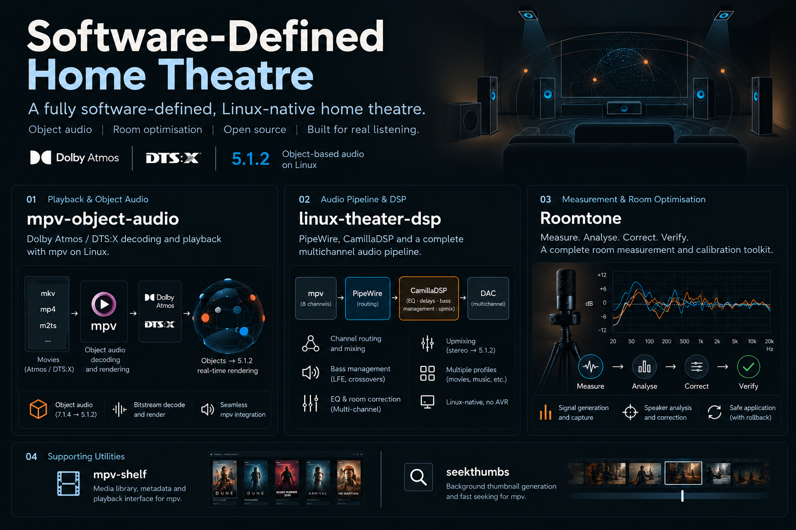

# Software-defined home theatre (Linux, Atmos 5.1.2)

**At a glance.** A Linux laptop decodes Dolby Atmos files live and renders the objects to a 5.1.2 speaker layout; a Logitech Z906 plus
two ceiling speakers play them, and a projector shows the picture on a DIY 107 inch screen. There is no AV receiver: CamillaDSP on the laptop does the
EQ, delays and trims, and the amplifiers only amplify.
**For:** people building a similar Linux Atmos setup, or checking how it was tuned. This is a build log with working scripts, not a packaged product.
**Needs:** Kubuntu 24.04, PipeWire, Omniphony, harletty-bridge, a patched mpv, CamillaDSP and a 7.1 USB interface (details under [Quick start](#quick-start-on-a-new-machine);
exact versions are still to be filled in, see [Still to fill in](#still-to-fill-in)).
**Status:** everything below was measured at one seat, in one room, with one microphone. "Measured" here means that; see [How much is measured?](#how-much-is-measured) and
[Uncertainty](#uncertainty) before relying on any number. The analysis code that produced the numbers was written with an AI assistant and has not been independently validated ([Authorship](#authorship-and-licence)).

Room: about 10 x 10 ft, light-controlled and acoustically treated, with no space behind the seat for rear speakers, so **5.1.2 is the
largest layout used here** (7.1.4 and 5.1.4 are deliberately not used).

## The repositories

The project started as one repository and was split into five repositories on 2026-10-25 (history preserved in each); a sixth, **mpv-shelf**, was added on 2026-10-26. This one, **sdht**, is the front door: the build log, documentation, results and graphs.

| Repository | What it is |
|---|---|
| **[sdht](https://github.com/praveenchandrahas/Software-Defined-Home-Theatre)** (this one) | documentation, build log, measurements' results and graphs, `preflight` health report, `clone-all.sh` / `test-all.sh` / `check-installed.sh`, the figure scripts |
| **[linux-theater-dsp](https://github.com/praveenchandrahas/linux-theater-dsp)** | `eq` / `theater-route` (PipeWire routing), `set-eq.py` (CamillaDSP profiles: bass EQ, delays, trims, bass management), the stereo and 5.1-bed upmixers (`upmix.py`), the adaptive ambience engine (`upmix_engine.py`) with its offline test harness (`tools/upmixtest`), the systemd units, router tests |
| **[mpv-object-audio](https://github.com/praveenchandrahas/mpv-object-audio)** | installer and wrapper for the live Atmos / DTS:X player (Omniphony, harletty-bridge, patched mpv) |
| **[seekthumbs](https://github.com/praveenchandrahas/seekthumbs)** | seek-bar thumbnails for a read-only film library (an rclone or debrid mount): built when you play a film (or as a batch), one set shared by the releases of a film, and the mpv viewer script |
| **[mpv-shelf](https://github.com/praveenchandrahas/mpv-shelf)** | a Netflix-style film browser inside mpv (poster grid, Continue Watching, search, title pages) over the same library folder; plays by file path |
| **[Roomtone](https://github.com/praveenchandrahas/Roomtone)** | `autocal` (measure the room through CamillaDSP and propose a correction), test signals, recording procedures and analysers (sweep, sub, dialogue, reflections, soundbar comparison, second-sub drift), microphone calibration (`miccal.py`), REW data, the local control page (live per-speaker levels on a 5.1.2 plan, EQ and profile controls, an autocal page) and the mpv status overlay (key **C**) |

**Why not just EasyEffects or PipeWire's upmix?** They target standard layouts and sit outside the room correction; this rig is 5.1.2 with measured per-speaker delays, trims and EQ, so the upmixer is written as CamillaDSP blocks in front of that chain. The comparison, and what the upmixers do not do, is in the [linux-theater-dsp README](https://github.com/praveenchandrahas/linux-theater-dsp#how-this-differs-from-easyeffects-and-other-generic-upmixers-and-why-this-route).

Clone them all side by side with `./scripts/clone-all.sh` (they find each other by folder name; `SDHT_WORKSPACE` overrides). In the prose below, a path such as `scripts/set-eq.py` or `tools/sweeptest/` refers to the repository in the table that owns it. Details: [docs/repo-split.md](docs/repo-split.md).

## Credits

This project is mostly glue and measurement. The hard part, decoding and rendering Atmos objects live on Linux, is the
work of others, and everything here stands on it:

- **[Omniphony](https://github.com/mgth/Omniphony)** by mgth: the object renderer (VBAP to any speaker layout), Omniphony
  Studio and the OSC control layer. **[mpv-omniphony](https://github.com/mgth/mpv-omniphony)** is the mpv integration
  used here. Thank you for building it and for merging the packaging fix so quickly.
- **[harletty-bridge](https://github.com/harletty/harletty-bridge)** by harletty: the decoder plugin (TrueHD and E-AC-3
  Atmos objects; its repository also carries DTS and DTS:X input support) that feeds Omniphony its objects.
- **[truehdd](https://github.com/truehdd/truehdd)** by Rainbaby, the open-source TrueHD Atmos decoder that the `harletty` decoder
  (inside harletty-bridge) is a fork of, per harletty's README. Without that work, none of this would be possible.
- Also used: [mpv](https://mpv.io), [libplacebo](https://code.videolan.org/videolan/libplacebo), [PipeWire](https://pipewire.org),
  [CamillaDSP](https://github.com/HEnquist/camilladsp), [Room EQ Wizard](https://www.roomeqwizard.com), and
  [Cavern](https://github.com/VoidXH/Cavern) (used for offline rendering before the live path existed).

How the Omniphony stack was built and debugged on this machine is in [docs/omniphony-debugging.md](https://github.com/praveenchandrahas/mpv-object-audio/blob/main/docs/omniphony-debugging.md).

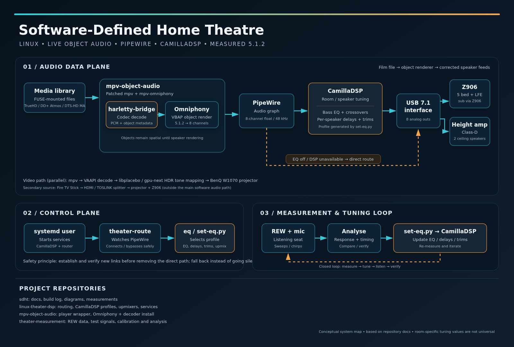

*The short version: what the audio passes through, what controls it, and how it is tuned. The next diagram has every component.*


*Every component, hardware and software. Dashed boxes are items still to confirm (see [todo-fill-in](docs/todo-fill-in.md)).*

**Words used below.** *Remux*: a lossless copy of a disc's video and audio streams in a new file.
*Bed* and *heights*: the five ear-level speakers and the two ceiling speakers. *LFE*: the sub channel. *VBAP*: the panning method Omniphony uses to place objects
between speakers. *OSC*: the network control protocol Omniphony uses. *LR4*: a 24 dB per octave crossover filter. *`drone2`*, *`thump20x`*, *`tight20x`*:
named bass EQ presets (`drone2` is the one in use). *Standing profile*: the settings applied at every start. *STI*, *C50*, *RT60*: speech-intelligibility, clarity
and reverberation measures. *BS.1116*: the ITU-R listening-room recommendation whose early-reflection limit (-10 dB) is used here. *Hot sub run*: the sub test repeated
at higher level. *Dolby Amaze*: Dolby's Atmos demo clip, in which Praveen hears a buzz. *Bar test*: a kit for comparing the rig with a soundbar.

## The build

The path of a film, from file to ears:

1. **Library.** Remuxes (TrueHD or DD+ Atmos, DTS-HD MA) on a FUSE-mounted media library.
2. **Decode and render, live.** [`mpv-atmos`](https://github.com/praveenchandrahas/mpv-object-audio/tree/main/scripts/mpv-atmos) runs a patched mpv ([mpv-omniphony](https://github.com/mgth/mpv-omniphony)).
   The [harletty-bridge](https://github.com/harletty/harletty-bridge) plugin decodes the Atmos bitstream into PCM plus object metadata,
   and [Omniphony](https://github.com/mgth/Omniphony) renders the objects to the 5.1.2 layout with VBAP, in real time.
   Objects stay objects until the final speaker feeds are computed.
3. **Picture.** The same mpv decodes video with VAAPI and renders with libplacebo (`gpu-next`), tone-mapping HDR down to
   the projector's measured 60 nits and converting to the BT.709 / BT.1886 the projector expects.
4. **Routing.** The renderer writes 8 channels (48 kHz, float) into PipeWire. A small router service links them
   through CamillaDSP and falls back to a direct route if CamillaDSP is not ready.
5. **DSP.** CamillaDSP applies the bass EQ, per-speaker delays and level trims (details below).
6. **Output.** A 7.1 USB interface sends front L/R, centre, surrounds and LFE to the Z906 (analog direct inputs)
   and the two height channels to a separate Class-D amplifier driving two ceiling speakers.
7. **Display.** The BenQ W1070 projector (1080p DLP) shows the picture on the screen. A Fire Stick 4K Max is a second
   source: HDMI through a TD-876H splitter to the projector, TOSLINK to the Z906.

### Hardware

| Part | What it is |
|------|-----------|
| Computer | Kubuntu 24.04 laptop, 11th-gen Intel i5, Iris Xe graphics (a desktop is planned) |
| Audio interface | Vantec 7.1 USB (C-Media class), analog 7.1 mode, 8 outputs |
| Bed speakers | Logitech Z906: front L/R, centre, two surrounds, sub |
| Height speakers | Two Samsung SWA-8500S speakers (the wireless surrounds of a Samsung HW-T670 soundbar system, now wired), on the ceiling, Salcon Class-D 2 x 50 W amplifier, no sub |
| Projector and screen | BenQ W1070; 107 inch 16:9 screen from sanded, sprayed gypsum board with a matte black painted border, later extended with a 4 inch black velvet border |
| Measurement | Dayton iMM-6S microphone on a separate USB adapter, Room EQ Wizard |
| On hold | Custom subwoofer (JBL A1500HI, 75 L vented): not in the signal chain |

The full hardware table, channel map and diagrams are in [docs/architecture.md](docs/architecture.md); the full story is in
[docs/technical-writeup.md](docs/technical-writeup.md).

### How it was built

| When (2026) | Milestone |
|-------------|-----------|
| Jul | Offline Atmos rendering with Cavernize into 5.1.2 files; fixed silent height channels with an index-based channel map |
| Jul | Found Omniphony and harletty-bridge as the first live, object-preserving Atmos path on Linux |
| Aug | Prebuilt mpv-omniphony had no audio or video backends; rebuilt from source against mpv 0.41.0 with 24 patches |
| Aug | First live object rendering confirmed in Omniphony Studio (16 object trails, 8 channels out through PipeWire) |
| Aug to Sep | `mpv-atmos` wrapper, projector-tuned tone-mapping, overlay control; virtual bed layout path bug reported and merged upstream |
| Oct 19 to 21 | CamillaDSP stage: bass voicing, speaker alignment, auto-routing and an EQ on/off switch |
| Oct 23 | Verification sweeps through CamillaDSP: delays confirmed, heights bass-managed and tone-matched, sub range measured, dialogue and reflection kits built |
| Oct 24 | Reboot test of the standing profile, stereo and 5.1 upmix presets, automatic profile selection, adaptive-ambience prototype |

Every problem met on the way, with cause and fix, is in [docs/omniphony-debugging.md](https://github.com/praveenchandrahas/mpv-object-audio/blob/main/docs/omniphony-debugging.md).

### The `mpv-atmos` command

[`scripts/mpv-atmos`](https://github.com/praveenchandrahas/mpv-object-audio/tree/main/scripts/mpv-atmos) is a reference copy of the wrapper: `--ad=orender` with the engine and bridge paths,
VAAPI decode, `--vo=gpu-next` on Vulkan, `--target-peak=60 --tone-mapping=bt.2390`, a Mitchell downscaler with linear,
corrected downscaling, and debanding. [`scripts/mpv-atmos-overlay-off.lua`](https://github.com/praveenchandrahas/mpv-object-audio/blob/main/scripts/mpv-atmos-overlay-off.lua) switches the
trajectory overlay off at file load. Paths are from Praveen's machine; adjust them.

## Tuning and automation (the CamillaDSP stage)

The most measured part of the project, and the newest. A Z906 hands every channel's bass to its sub, which together with
the room gives one big bass hump near 60 Hz, so the stage is tuned from recordings made at the listening seat.

| Part | What it does | Where |
|------|--------------|-------|
| **Auto-routing** | Starts with the system, links mpv to CamillaDSP to the USB interface by itself, falls back to a direct route; `eq ensure` starts CamillaDSP and the router if they are down | `scripts/theater-route`, `scripts/install-autoroute.sh` |
| **EQ switch** | `eq off` / `eq on` / `eq toggle` / `eq status`: bypass all DSP instantly, mid-film | same script, installed as `eq` |
| **Preset switcher** | Writes the CamillaDSP config for a named bass preset plus alignment, heights processing and upmix, validates it, restarts the service and relinks. With no arguments it loads the **standing profile** | `scripts/set-eq.py`, `scripts/make-default.sh` |
| **Heights processing** | LR4 high-pass at 140 Hz on the heights, their bass summed into the LFE, fitted tone filters and a +1.0 dB trim (`--heights`, `--heights-tone`) | `scripts/set-eq.py` |
| **Upmix** | Stereo to 5.1.2 (fixed matrix, or adaptive with `stereo-ad`) and 5.1 bed to 5.1.2 (`--upmix=stereo\|stereo-ad\|bed[:flavour]`), three flavours each | `scripts/upmix.py` |
| **Adaptive ambience engine** | Streaming STFT process that separates direct sound from ambience and feeds only the ambience to the surrounds and heights; about 4 % of one core and 21 ms on the rear feeds only, per [runbook.md](docs/runbook.md) (not re-measured on the live rig); started by the router, falls back to the fixed matrix if it does not come up | `scripts/upmix_engine.py` (`eq engine`) |
| **Automatic profile** | Chrome playing selects the stereo upmix; for mpv the source is read over IPC (Atmos is film, 5.1 is bed, stereo is stereo upmix); idle is film | `scripts/theater-route` (`eq mode`, `eq source`) |
| **Measurement kits** | Chirp delay test, sweep test, sub test, dialogue test, early-reflection analysis, bar test, upmix evaluation | `tools/` (see layout below) |
| **Tests** | Router and config-generator tests (51 router checks) that need no audio hardware | `tests/run.sh` |

Current tuning is the **standing profile**, `./scripts/set-eq.py` with no arguments (`--set=drone2 --align --heights
--heights-tone`), installed by `scripts/make-default.sh` and applied by `eq ensure` whenever `mpv-atmos` starts:

- **`drone2`** bass preset: cut-only, strong thump with the 63 to 92 Hz drone tamed ([tuning-log](docs/tuning-log.md)).
- **`--align`**: per-speaker delays and trims so that the seven full-range speakers arrive within about 0.2 ms of each other at the seat in the first sweep run (the sub arrives 6 to 7 ms late and is not yet compensated; see A3 and [alignment](docs/alignment.md)).
- **`--heights`, `--heights-tone`**: the heights cannot reproduce bass, so it goes to the sub, and their tone is moved towards the bed's (about 1 dB rms closer; see A4).

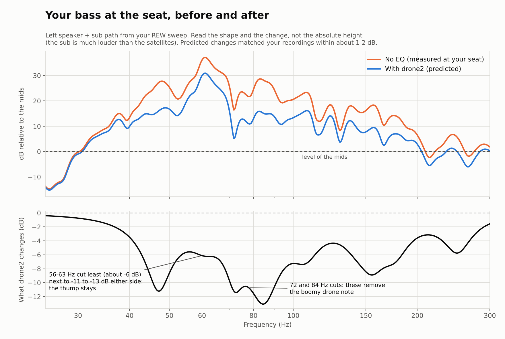


*Values as recorded in [status.md](docs/status.md) and [alignment.md](docs/alignment.md), from the 2026-10-23 sweep runs; the raw recordings are not in the repository.
The heights' bass "before" figure is the heights alone with no sub feed (41 dB rms per analysis bin, about 27 dB with 1/6-octave smoothing).*

The upmix presets are measured offline only so far, on synthetic test signals. The adaptive ambience engine (`scripts/upmix_engine.py`, used by the stereo upmix by default, with an automatic fall-back to the fixed matrix; not yet run against real PipeWire) separates
instrument from ambience far better than the fixed side-signal matrix on synthetic harmonic notes, and no better on noise
([tools/upmixtest](https://github.com/praveenchandrahas/linux-theater-dsp/blob/main/tools/upmixtest/README.md)). The metric is the ambience kept in the surrounds minus the instrument leaking into them, in dB. It says nothing yet about music:


### Daily use

The intended behaviour is that you do nothing: start mpv (or `mpv-atmos`) and within half a second its channels are linked through CamillaDSP. This is tested in simulation and after a reboot away from the rig, not yet on the rig itself (see the table below).

```bash
eq status    # what is routed where right now, which preset is loaded
eq off       # bypass: bass EQ, delays and level trims all off
eq on        # back to the tuned sound
eq toggle    # flip, handy on a keyboard shortcut
```

More in [docs/runbook.md](docs/runbook.md); when something misbehaves, [docs/troubleshooting.md](docs/troubleshooting.md).

## How much is measured?

Claim by claim in [docs/status.md](docs/status.md) (updated 2026-10-24). "Measured" means measured at one seat with one microphone. In short:

| Measured, and confirmed by listening or a second run | Measured once, not confirmed afterwards | Not yet tested on the real system |
|---|---|---|
| Bass voicing (`drone2`), by recordings and listening | Level trims: within about 2 dB in each run, but the same speaker moves by up to about 2.5 dB between runs (mic position) | Auto-routing and the `eq` switch (simulated only) |
| Speaker delays: the seven full-range speakers within 0.2 ms of FL in sweep run 1 (up to 0.6 ms in run 2, mic moved). **The sub arrives 6 to 7 ms after FL and is not compensated** | Heights bass management: heights + sub within 2.6/2.7 dB rms of the bed over 40-400 Hz (the heights alone: 41 dB). Heights tone: 3.1/3.5 dB rms from the bed against 4.5/4.1, about 1 dB closer, inside the run-to-run noise. Trim lowered to +1.0 dB, not re-measured | Routing to the rig after a reboot (needs the USB interface connected) |
| Live Atmos object rendering through the whole chain | Sub range: harmonics below 3 % down to about 40 Hz, usable to 36 Hz, nothing usable under 22 Hz | Automatic profile switching (Chrome, 5.1, stereo) |
| Services and standing profile start at boot (2026-10-24, away from the rig) | Early reflections: FC and FR meet the ITU-R BS.1116 limit; FL and both heights exceed it by one reflection each; panel effect untested | Upmix presets by ear (measured offline only) |
| Lip-sync: Praveen's listening, not measured | Dialogue kit (2026-10-24): STIPA-style STI 0.79 to 0.83, dialogue 13 to 18 dB above the noise; centre has +5.7 dB boom and -3.3 dB presence | |
| | Polarity: all speakers in phase | |

**Open:** a rattle or buzz in loud bass scenes. Praveen hears it as sub-cabinet rattle; steady tones at -14 dBFS do not
reproduce it, and the Dolby Amaze recording shows no fixed 100 Hz line that would separate cabinet rattle from a room mode. In the hot sub run the recording peaks at the same level on eight tones, which points at a limit in the
chain that has not been located. Next step is the same kit at a lower level and a different mic position, and at -8 and -3 dBFS ([tools/subtest](https://github.com/praveenchandrahas/Roomtone/blob/main/tools/subtest/README.md)).

## Uncertainty

One room, one seat, one microphone (a Dayton iMM-6S on its own USB clock), no absolute level calibration. The microphone was not in exactly the same spot between the two sweep runs, so
single frequency bins moved by 3 to 7 dB and one speaker's level by about 2.5 dB; read band averages, not single points. Differences under about 2 dB per band or 0.03 STI are within
repeatability. The capture chain caps at about -6 dBFS in the hot sub run, and its floor above 4 kHz may set the noise values. STI is a STIPA-style estimate without auditory masking, not a certified measurement. The
"after" bass curve in A1 is computed, not recorded. The analysis code (sweep, sub, dialogue, reflection and rattle analysers) was written with an AI assistant and has not been independently validated; where a number matters, check it against
the raw REW exports in `data/rew/`.

## Repository layout

```
docs/        the documentation (start with architecture.md and runbook.md); docs/graphs/ holds every graph, docs/img the diagrams
scripts/     preflight (read-only health report), collect-versions.sh, clone-all.sh, test-all.sh
tools/       the figure and diagram generators: make-graphs.py, make-recording-graphs.py, make-verification-figures.py,
             make-architecture-diagram.py, make-system-overview.py, build-writeup-page.py
             (they read the other repositories: set-eq.py from linux-theater-dsp, REW data and analysers from Roomtone (formerly theater-measurement))
```

Everything else (router, upmix engine, player installer, thumbnails, measurement kits) is in the repositories listed above.

## Quick start on a new machine

Two steps cover the software. Start from Kubuntu 24.04 (or another Ubuntu 24.04 derivative) with PipeWire running, the 7.1 USB interface plugged in, and [CamillaDSP](https://github.com/HEnquist/camilladsp/releases) installed as `/usr/local/bin/camilladsp` (not scripted yet; see [docs/installation.md](docs/installation.md)).

**1. The player: Omniphony, harletty-bridge and mpv-omniphony, as the `mpv-object-audio` command.**

```bash
git clone https://github.com/praveenchandrahas/Software-Defined-Home-Theatre && ./sdht/scripts/clone-all.sh     # all repositories, side by side
cd mpv-object-audio
./scripts/object-audio-install.sh deps      # prints one apt line (mpv's build dependencies); run what it prints
./scripts/object-audio-install.sh           # the engine and the decoder bridges are downloaded as prebuilt releases;
                                            # mpv-omniphony has no releases, so mpv is built from source (several minutes)
mpv-object-audio film.mkv                   # or right-click a film in Dolphin -> mpv-object-audio
```

Everything goes into `~/.local/opt/mpv-object-audio`; the installer stops, and installs no command, unless the new mpv loads the engine. Re-running it updates to the latest releases. [`mpv-object-audio`](https://github.com/praveenchandrahas/mpv-object-audio/tree/main/scripts/mpv-object-audio) carries the video settings described under [The `mpv-atmos` command](#the-mpv-atmos-command) and is independent of `mpv-atmos`. The installer also adds a Dolphin right-click submenu (play, fullscreen, play with log, show streams) and an "Open with" entry. `scripts/object-audio-install.sh status` and `remove` do what they say. Details and caveats: [docs/installation.md](docs/installation.md#mpv-object-audio-the-omniphony-player-stack-2026-10-25).

**Optional: seek-bar thumbnails for a film library.** [seekthumbs](https://github.com/praveenchandrahas/seekthumbs) makes small preview thumbnails (about 1 MB per film at the default size, kept in a local folder) and a replacement `thumbfast.lua` shows them on the mpv seek bar without opening the film a second time. It builds them when you first play a film (gently, next to the playback) or as a batch; releases of the same film share one set, and `skip_tv` / `exclude` leave out what you do not want. On a debrid mount a 4K remux needed about 17 minutes to build under the mount's rate limits, so building on play is the practical mode there. The viewer has so far been run only against a mocked mpv, not in real mpv with uosc. Setup and caveats are in its README.

**Optional: a film browser in mpv.** [mpv-shelf](https://github.com/praveenchandrahas/mpv-shelf) (Ctrl+b) browses the same library folder as a poster grid with Continue Watching, search and title pages (posters and synopses from TMDB with your own free key; works without), groups releases into one card per film, and plays by file path so seekthumbs and the Atmos wrapper keep working. Version 1; like the viewer above it has only been tested against a mocked mpv.

**2. The DSP and routing: CamillaDSP profile, router and the `eq` command.**

```bash
cd ../linux-theater-dsp                         # the upmixers are part of this repository
./scripts/make-default.sh                   # writes and loads the standing profile, installs the router and `eq`, enables the services
```

Then run `../sdht/scripts/preflight` (read-only health report) before the first film. Speaker layout, Omniphony's own configuration and the room-specific numbers (delays, trims, EQ) are the owner's and must be re-measured for any other room; see [docs/runbook.md](docs/runbook.md).

*Status:* step 1 was run on the rig on 2026-10-25 (engine v0.7.0 and bridges v0.9.0 loaded; an Atmos TrueHD clip and a DTS:X clip played and were heard). Not yet checked with the DAC connected: routing through CamillaDSP, and the level against `mpv-atmos` (the new engine applies a -8 dB dialogue normalisation on the Atmos clip); see [docs/todo-fill-in.md](docs/todo-fill-in.md) and `scripts/preflight playing` / `compare`.

## Still to fill in

Not yet recorded, so not stated here (the checklist is [docs/todo-fill-in.md](docs/todo-fill-in.md); `TODO(owner)` marks the spots in the docs):

- Recorded on 2026-10-24: PipeWire 1.0.5, WirePlumber 0.4.17, CamillaDSP 4.1.3, liborender 0.3.0 (omniphony-studio 0.4.2), mpv 0.41.0 (patched, built from source); see [docs/installation.md](docs/installation.md#2-player-stack). TODO: the harletty-bridge commit (the library carries no version) and the Omniphony commit. There is no `mpv.conf`: mpv is configured in the `mpv-atmos` wrapper.
- TODO: bill of materials with sources and prices, the media-library mount and the laptop-to-projector HDMI path.
- TODO: CPU and latency of the live decode and render chain (the 4 % and 21 ms figures are for the upmix engine only).
- TODO: whether DTS:X works on this rig (harletty-bridge advertises DTS and DTS:X input; it has not been tested here).
- TODO: microphone calibration file, mic position and playback level of the tests; projector fan state during the noise measurement.
- TODO: which scripts predate the October working sessions.

The checks still to do at the rig are in [docs/status.md](docs/status.md#checks-still-to-do).

**Safety.** The sweeps and tone tests play loud, sustained low frequencies: start low, keep the sub away from your ears, and note that high-level tones can damage drivers. The height amplifier and speaker wiring are mains-powered and
should only be rebuilt by someone who knows what they are doing.

## Authorship and licence

The tuning decisions, measurements, listening tests and the build itself are Praveen's. The scripts, the analysis code and first drafts of these documents were written with Claude (Anthropic) in working sessions, mainly 2026-10-20 to 2026-10-24
(TODO: which scripts, if any, predate that). This includes the code that produces the numbers: the sweep, sub, dialogue (STI) and reflection analysers and the rattle detector. It has been checked against simulated rooms and against the REW exports,
not independently validated.

**Licence: [Apache License 2.0](LICENSE)**, for all six repositories. It lets anyone use, change and redistribute the work, including commercially, and it carries an explicit patent grant and a "no warranty" clause. Most of the project is integration of other people's software
(Omniphony, truehdd, CamillaDSP, PipeWire, mpv, ffmpeg and others); those keep their own licences and are not relicensed by this one. Where this project's code is combined with GPL software (Omniphony, CamillaDSP, mpv are GPL), the combined program you run is GPL-covered,
but nothing in these repositories copies their code, so Apache-2.0 for the scripts is consistent. A third-party table is in the [mpv-object-audio README](https://github.com/praveenchandrahas/mpv-object-audio#licences-of-what-it-installs). Licences of harletty-bridge and mpv-omniphony are not yet verified.
Dolby, Dolby Atmos, DTS and DTS:X are trademarks of their owners; this project is not affiliated with or endorsed by them, and contains no copyrighted films, decoders or encoded media.

**What is public.** Everything except credentials. There are none in the repositories (they were scanned before publication); keep it that way: never commit tokens, `rclone.conf`, or anything under `~/.config` with secrets.

## Adapting this to your system

The files describe one particular rig and contain paths, names and numbers from it: a home folder such as `/home/praveen`, the Vantec 7.1 USB interface and its PipeWire node names, the speaker layout (5.1.2 with a Z906 and ceiling heights), delays, trims and EQ measured in one room, and the library and rclone mount paths.
**Change these to match your own system before running anything.** The delays, trims and EQ in particular are only valid for that room and must be re-measured for yours ([docs/runbook.md](docs/runbook.md)). Scripts that install anything say so before they do, and `scripts/check-installed.sh` and `scripts/preflight` only read.

## Checking the install and the tests

- `scripts/check-installed.sh [--diff]` compares the scripts installed in `~/.local/bin` with the repository copies. It is read-only: it writes nothing, installs nothing, uses no network and no `sudo`; when something differs it only prints the command you could run.
- Each repository has a GitHub Actions workflow (`.github/workflows/test.yml`) that runs its tests on GitHub's servers with read-only permissions and no secrets. It never touches your machine; your machine is not connected to GitHub in any way by this.

## Appendix: the main graphs

All twenty-one graphs are in [docs/graphs/](docs/graphs/) (index and sources in its [README](docs/graphs/README.md)); these are the nine
that matter most. Every figure says in its caption which parts are real REW data, which are computed from the filter definitions
in `scripts/set-eq.py`, and which are values quoted from the measurement reports. Figures 03, 06, 07, 08, 08b and 12 to 19 are drawn from the raw recordings by
`tools/make-recording-graphs.py` (the recordings themselves are not in the repository).

### A1. The bass problem and the drone2 fix

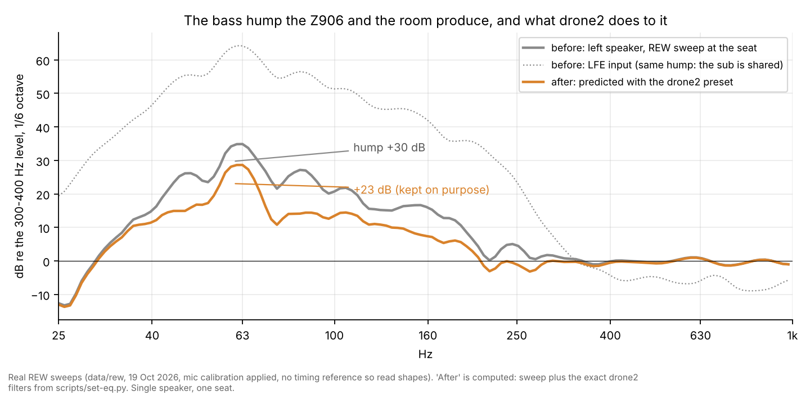

The Z906 sends every channel's bass to its sub, and the room adds a strong mode at 56 to 63 Hz, so the seat sees a peak about 35 dB over the 300 to 400 Hz level at 63 Hz (about 31 dB averaged over 50 to 70 Hz, as quoted in fig 09). `drone2` takes about 6 dB off the peak and about 13 dB off the 63 to 92 Hz drone region, and keeps
the thump on purpose. The "after" curve is the sweep plus the exact filters, computed, not recorded.

### A2. Prediction against recording

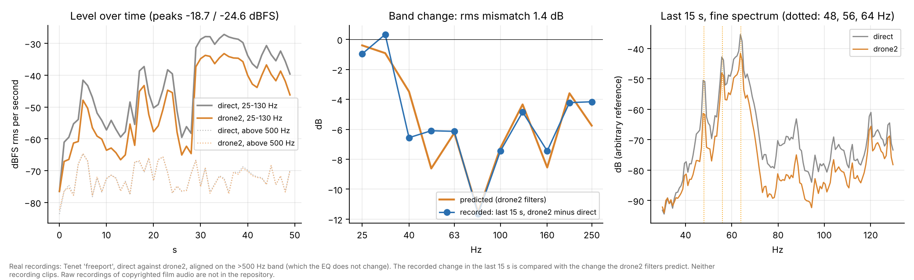

Tenet "freeport", direct against `drone2`, aligned on the part of the signal the EQ does not touch. The recorded band changes follow the filter curve with 1.4 dB rms
mismatch (the 40 Hz band is 3 dB deeper than predicted); neither recording clips.

### A3. Alignment: delays and trims

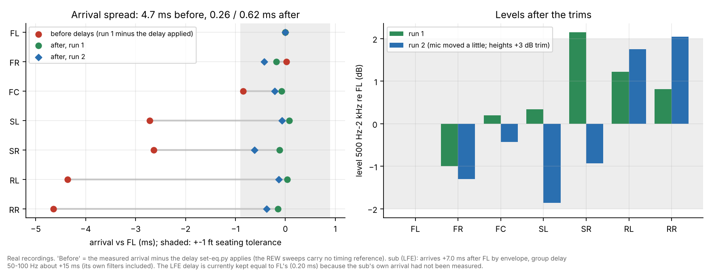

Redrawn from the recordings. The seven full-range speakers arrive within 0.26 ms (run 1) and 0.62 ms (run 2) of each other, against about 4.7 to 4.9 ms before the delays (two reconstructions of the same quantity); levels sit within about 2 dB in each run, and the same speaker
moves by up to about 2.5 dB between runs. The "before" arrivals are the measured ones minus the applied delay. **The sub (LFE) arrives 6 to 7 ms after the front left** (group delay near 15 ms at 50 to 100 Hz), yet its delay is
still kept equal to FL's; see [status](docs/status.md).

### A4. Heights: tone-match and bass management

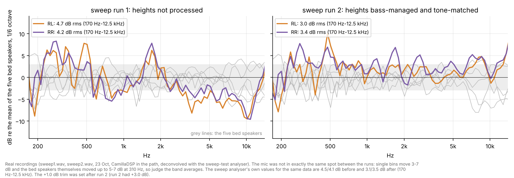

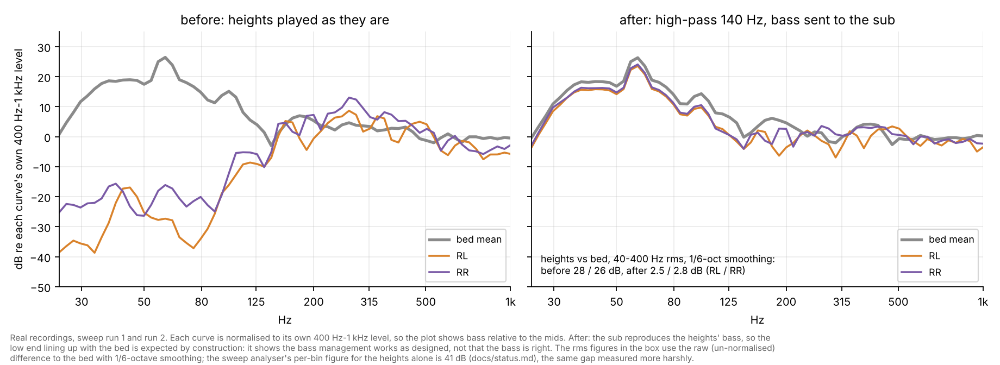

The ceiling speakers have no output below about 125 Hz, so their bass is sent to the sub, and three fitted filters pull their tone towards the bed
(from 4.5 / 4.1 to 3.1 / 3.5 dB rms against the bed, 170 Hz to 12.5 kHz in the sweep analyser's report; the figure's own 1/6-octave smoothing gives 4.7 / 4.2 to 3.0 / 3.4). The mic moved a little between the two runs and single bins move 3 to 7 dB, so this is a
modest improvement of about 1 dB, inside the run-to-run noise, not a precise match. The bass curves line up with the bed by construction, since the sub plays the heights' bass; that shows the bass management works as designed, not that the bass is right.

### A5. The sub and the room modes

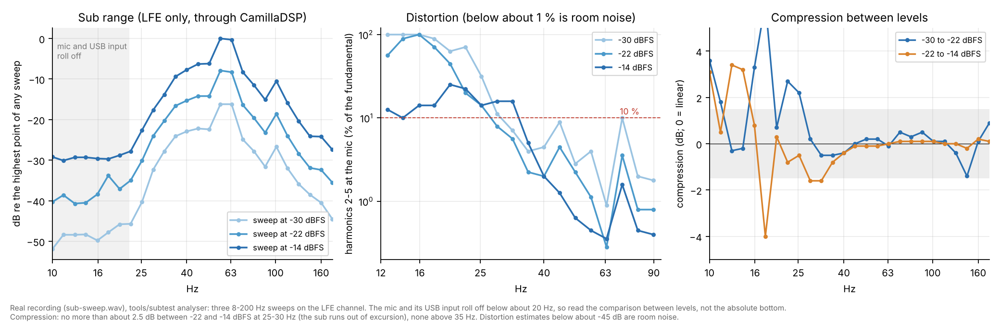

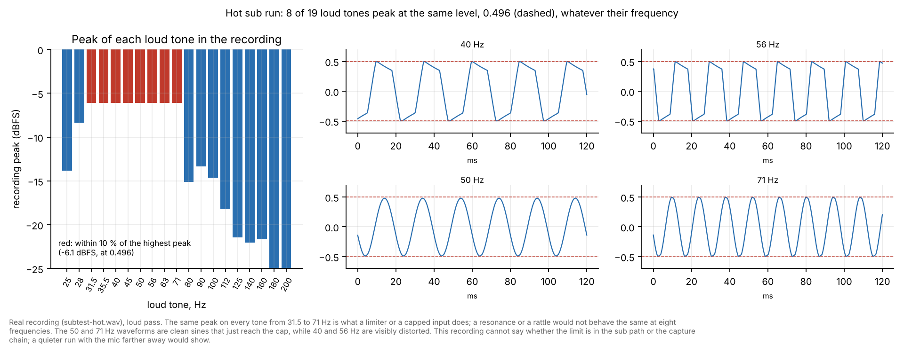

"Clean" means harmonics below -30 dB (3 %), the analyser's own scale: about 2 % at 40 Hz at -14 dBFS, 5 % at 36 Hz (usable), 14 to 16 % at 25 to 31 Hz, nothing usable under 22 Hz. Compression is about 2 to 3 dB at 22 to 25 Hz and none above 35 Hz. The stepped-tone rattle hunt flags nothing (`16_rattle_hunt.png`);
the loud-scene buzz is still open ([status](docs/status.md)). In the hot run the recording peaks at the same level on eight tones from 31.5 to 71 Hz, which points at a limit in the chain
rather than a rattle; the recording cannot say where, and it means the distortion figures rest on a capture chain that is only shown to be clean up to the -14 dBFS test level.

### A6. Dialogue

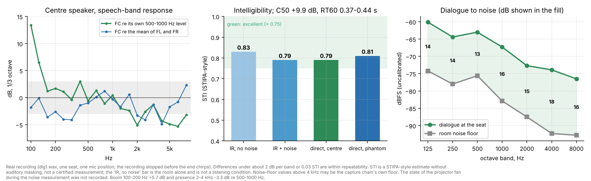

Real recording of the dialogue kit in the room (dlg1.wav). The STIPA-style estimate is 0.79 with the measured noise (0.83 for the room alone), which is in the "excellent" band of the STI scale (above 0.75). Dialogue sits 13 to 18 dB above the room noise
in every octave band (uncalibrated levels). The phantom centre (FL + FR) scores 0.81 against 0.79 for the real centre, which is the same within repeatability (0.03). The centre speaker is not flat: +5.7 dB at 100 to 200 Hz and -3.3 dB at 2 to 4 kHz against 500 to 1000 Hz.

### A7. Early reflections

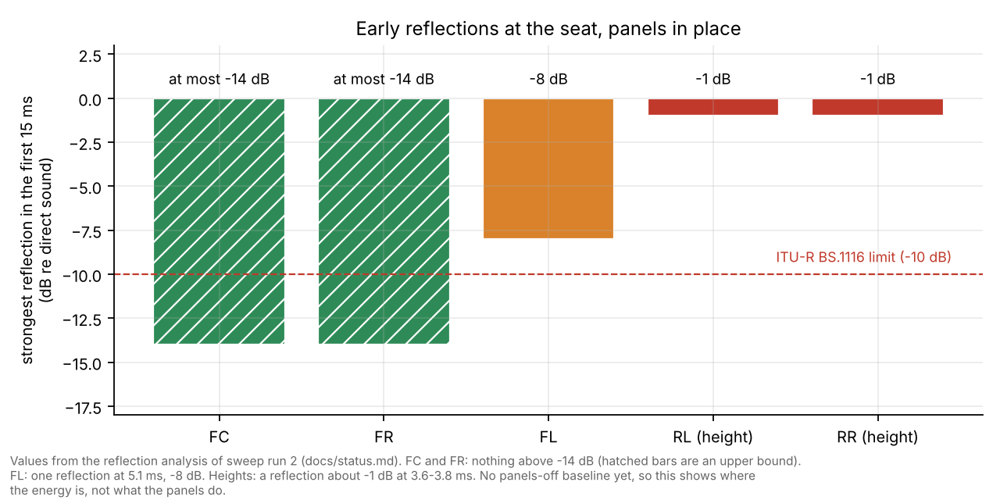

Measured on sweep run 2: centre (-14.1 dB) and front right (-13.8 dB) meet the ITU-R BS.1116 limit of -10 dB; the front left exceeds it with one reflection at 5.1 ms (-8.4 dB, which is within the repeatability of the method),
and both heights have one almost as strong as the direct sound (-1.3 and -0.6 dB at 3.6 and 3.8 ms). The BS.1116 limit is written for ear-level listening rooms; applying it to ceiling speakers is a stretch, so read the heights as "strong early reflection", not "fail". There is no panels-off baseline yet, so this shows where the energy is, not what the panels do.
The summary bar chart is `08b_early_reflections_summary.png`.

### Also in the folder

| File | Shows |
|---|---|
| `02_filter_sets.png` | Predicted response of each bass preset, and the predicted bass-to-mids balance on the two test items |
| `09_before_after_summary.png` | Bass hump, bed level spread, arrival spread and the heights' bass gap, before and after |
| `10_verification_summary.png` | Delays, levels and heights results of the 23 Oct sweep runs |
| `11_upmix_adaptive_vs_fixed.png` | Adaptive ambience prototype against the fixed matrix (offline only) |

| `08b_early_reflections_summary.png` | Strongest early reflection per speaker |
| `14_tone_each_speaker.png` | Tone of each of the seven speakers against the bed |
| `16_rattle_hunt.png` | Stepped-tone rattle hunt |
| `18_amaze_buzz.png` | Dolby Amaze clip spectra |
| `19_presets_recorded_vs_predicted.png` | `thump20x` and `tight20x`, recorded against predicted |
| `20_room_modes.png` | Room modes in the LFE sweep, with the sub-range values quoted from the report |

Regenerate with `python3 tools/make-graphs.py`, `python3 tools/make-verification-figures.py` and, with the recordings, `python3 tools/make-recording-graphs.py --help` (numpy, scipy and matplotlib).
