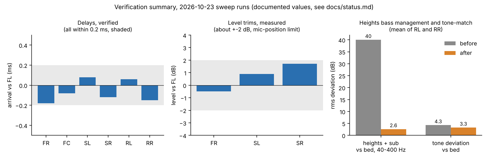
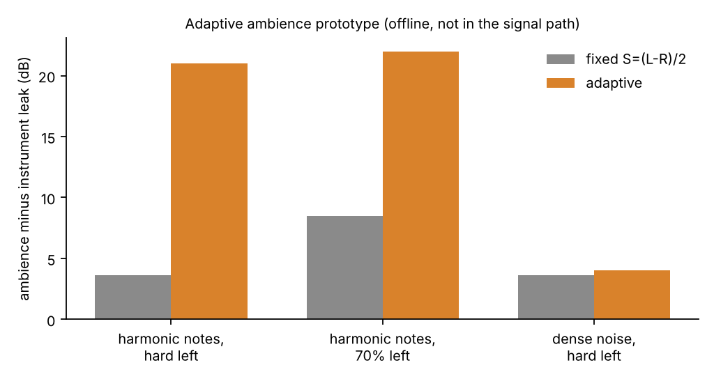

# Software-defined home theatre (Linux, Atmos 5.1.2)

A home theatre with no receiver and no processor: a Linux laptop decodes Dolby Atmos remuxes live, renders the
objects to a 5.1.2 speaker layout, and drives a Logitech Z906 plus two ceiling height speakers through a 7.1 USB
interface, while a 1080p projector shows the picture on a DIY 107 inch screen. This repository documents how it was
built, how it runs, and how it was tuned.

Room: about 10 x 10 ft, light-controlled and acoustically treated, no space behind the seat, so **5.1.2 is the
largest sensible layout** (7.1.4 and 5.1.4 are deliberately not used).

## Credits

This project is mostly glue and measurement. The hard part, decoding and rendering Atmos objects live on Linux, is the
work of others, and everything here stands on it:

- **[Omniphony](https://github.com/mgth/Omniphony)** by mgth: the object renderer (VBAP to any speaker layout), Omniphony
  Studio and the OSC control layer. **[mpv-omniphony](https://github.com/mgth/mpv-omniphony)** is the mpv integration
  used here. Thank you for building it and for merging the packaging fix so quickly.
- **[harletty-bridge](https://github.com/harletty/harletty-bridge)** by harletty: the decoder plugin (TrueHD and E-AC-3
  Atmos objects; its repository also carries DTS and DTS:X input support) that feeds Omniphony its objects.
- **[truehdd](https://github.com/truehdd/truehdd)** by Rainbaby, the open-source TrueHD Atmos decoder that the `harletty` decoder
  (inside harletty-bridge) is a fork of, per harletty's README. Without that work, none of this would be possible.
- Also used: [mpv](https://mpv.io), [libplacebo](https://code.videolan.org/videolan/libplacebo), [PipeWire](https://pipewire.org),
  [CamillaDSP](https://github.com/HEnquist/camilladsp), [Room EQ Wizard](https://www.roomeqwizard.com), and
  [Cavern](https://github.com/VoidXH/Cavern) (used for offline rendering before the live path existed).

How the Omniphony stack was built and debugged on this machine is in [docs/omniphony-debugging.md](docs/omniphony-debugging.md).


*Every component, hardware and software. Dashed boxes are items still to confirm (see [todo-fill-in](docs/todo-fill-in.md)).*

## The build

The path of a film, from file to ears:

1. **Library.** Remuxes (TrueHD or DD+ Atmos, DTS-HD MA) on a FUSE-mounted media library.
2. **Decode and render, live.** [`mpv-atmos`](scripts/mpv-atmos) runs a patched mpv ([mpv-omniphony](https://github.com/mgth/mpv-omniphony)).
   The [harletty-bridge](https://github.com/harletty/harletty-bridge) plugin decodes the Atmos bitstream into PCM plus object metadata,
   and [Omniphony](https://github.com/mgth/Omniphony) renders the objects to the 5.1.2 layout with VBAP, in real time.
   Objects stay objects until the final speaker feeds are computed.
3. **Picture.** The same mpv decodes video with VAAPI and renders with libplacebo (`gpu-next`), tone-mapping HDR down to
   the projector's measured 60 nits and converting to the BT.709 / BT.1886 the projector expects.
4. **Routing.** The renderer writes 8 channels (48 kHz, float) into PipeWire. A small router service links them
   through CamillaDSP and falls back to a direct route if CamillaDSP is not ready.
5. **DSP.** CamillaDSP applies the bass EQ, per-speaker delays and level trims (details below).
6. **Output.** A 7.1 USB interface sends front L/R, centre, surrounds and LFE to the Z906 (analog direct inputs)
   and the two height channels to a separate Class-D amplifier driving two ceiling speakers.
7. **Display.** The BenQ W1070 projector (1080p DLP) shows the picture on the screen. A Fire Stick 4K Max is a second
   source: HDMI through a TD-876H splitter to the projector, TOSLINK to the Z906.

### Hardware

| Part | What it is |
|------|-----------|
| Computer | Kubuntu 24.04 laptop, 11th-gen Intel i5, Iris Xe graphics (a desktop is planned) |
| Audio interface | Vantec 7.1 USB (C-Media class), analog 7.1 mode, 8 outputs |
| Bed speakers | Logitech Z906: front L/R, centre, two surrounds, sub |
| Height speakers | Two Samsung SWA-8500S speakers (the wireless surrounds of a Samsung HW-T670 soundbar system, now wired), on the ceiling, Salcon Class-D 2 x 50 W amplifier, no sub |
| Projector and screen | BenQ W1070; 107 inch 16:9 screen from sanded, sprayed gypsum board with a matte black painted border, later extended with a 4 inch black velvet border |
| Measurement | Dayton iMM-6S microphone on a separate USB adapter, Room EQ Wizard |
| On hold | Custom subwoofer (JBL A1500HI, 75 L vented): not in the signal chain |

The full hardware table, channel map and diagrams are in [docs/architecture.md](docs/architecture.md); the full story is in
[docs/technical-writeup.md](docs/technical-writeup.md).

### How it was built

| When (2026) | Milestone |
|-------------|-----------|
| Jul | Offline Atmos rendering with Cavernize into 5.1.2 files; fixed silent height channels with an index-based channel map |
| Jul | Found Omniphony and harletty-bridge as the first live, object-preserving Atmos path on Linux |
| Aug | Prebuilt mpv-omniphony had no audio or video backends; rebuilt from source against mpv 0.41.0 with 24 patches |
| Aug | First live object rendering confirmed in Omniphony Studio (16 object trails, 8 channels out through PipeWire) |
| Aug to Sep | `mpv-atmos` wrapper, projector-tuned tone-mapping, overlay control; virtual bed layout path bug reported and merged upstream |
| Oct 19 to 21 | CamillaDSP stage: bass voicing, speaker alignment, auto-routing and an EQ on/off switch |
| Oct 23 | Verification sweeps through CamillaDSP: delays confirmed, heights bass-managed and tone-matched, sub range measured, dialogue and reflection kits built |
| Oct 24 | Reboot test of the standing profile, stereo and 5.1 upmix presets, automatic profile selection, adaptive-ambience prototype |

Every problem met on the way, with cause and fix, is in [docs/omniphony-debugging.md](docs/omniphony-debugging.md).

### The `mpv-atmos` command

[`scripts/mpv-atmos`](scripts/mpv-atmos) is a reference copy of the wrapper: `--ad=orender` with the engine and bridge paths,
VAAPI decode, `--vo=gpu-next` on Vulkan, `--target-peak=60 --tone-mapping=bt.2390`, a Mitchell downscaler with linear,
corrected downscaling, and debanding. [`scripts/mpv-atmos-overlay-off.lua`](scripts/mpv-atmos-overlay-off.lua) switches the
trajectory overlay off at file load. Paths are from the owner's machine; adjust them.

## Tuning and automation (the CamillaDSP stage)

The most measured part of the project, and the newest. A Z906 hands every channel's bass to its sub, which together with
the room gives one big bass hump near 60 Hz, so the stage is tuned from recordings made at the listening seat.

| Part | What it does | Where |
|------|--------------|-------|
| **Auto-routing** | Starts with the system, links mpv to CamillaDSP to the USB interface by itself, falls back to a direct route; `eq ensure` starts CamillaDSP and the router if they are down | `scripts/theater-route`, `scripts/install-autoroute.sh` |
| **EQ switch** | `eq off` / `eq on` / `eq toggle` / `eq status`: bypass all DSP instantly, mid-film | same script, installed as `eq` |
| **Preset switcher** | Writes the CamillaDSP config for a named bass preset plus alignment, heights processing and upmix, validates it, restarts the service and relinks. With no arguments it loads the **standing profile** | `scripts/set-eq.py`, `scripts/make-default.sh` |
| **Heights processing** | LR4 high-pass at 140 Hz on the heights, their bass summed into the LFE, fitted tone filters and a +1.0 dB trim (`--heights`, `--heights-tone`) | `scripts/set-eq.py` |
| **Upmix** | Stereo to 5.1.2 and 5.1 bed to 5.1.2 (`--upmix=stereo\|bed[:flavour]`), three flavours each | `scripts/upmix.py` |
| **Automatic profile** | Chrome playing selects the stereo upmix; for mpv the source is read over IPC (Atmos is film, 5.1 is bed, stereo is stereo upmix); idle is film | `scripts/theater-route` (`eq mode`, `eq source`) |
| **Measurement kits** | Chirp delay test, sweep test, sub test, dialogue test, early-reflection analysis, bar test, upmix evaluation | `tools/` (see layout below) |
| **Tests** | Router and config-generator tests (51 router checks) that need no audio hardware | `tests/run.sh` |

Current tuning is the **standing profile**, `./scripts/set-eq.py` with no arguments (`--set=drone2 --align --heights
--heights-tone`), installed by `scripts/make-default.sh` and applied by `eq ensure` whenever `mpv-atmos` starts:

- **`drone2`** bass preset: cut-only, strong thump with the 63 to 92 Hz drone tamed ([tuning-log](docs/tuning-log.md)).
- **`--align`**: per-speaker delays and trims so all eight speakers arrive together at the seat ([alignment](docs/alignment.md)).
- **`--heights`, `--heights-tone`**: the heights cannot reproduce bass, so it goes to the sub, and their tone is fitted to the bed.




*Values as recorded in [status.md](docs/status.md) and [alignment.md](docs/alignment.md), from the 2026-10-23 sweep runs. The
raw recordings are not in the repository. The heights "before" figure is approximate (about 40 dB).*

The upmix presets are measured offline only so far. The adaptive-ambience prototype (not in the signal path) separates
instrument from ambience far better than the fixed side-signal matrix on spectrally sparse sources, and no better on noise
([tools/upmixtest](tools/upmixtest/README.md)):



### Daily use

You do nothing. Start mpv (or `mpv-atmos`); within half a second its channels are linked through CamillaDSP.

```bash
eq status    # what is routed where right now, which preset is loaded
eq off       # bypass: bass EQ, delays and level trims all off
eq on        # back to the tuned sound
eq toggle    # flip, handy on a keyboard shortcut
```

More in [docs/runbook.md](docs/runbook.md).

## How much is verified?

Claim by claim in [docs/status.md](docs/status.md) (updated 2026-10-24). In short:

| Verified (measured and confirmed) | Measured, not confirmed afterwards | Not yet tested on the real system |
|---|---|---|
| Bass voicing (`drone2`), by recordings and listening | Level trims, within about 2 dB (mic-position limit) | Auto-routing and the `eq` switch (simulated only) |
| Speaker delays, all eight within 0.2 ms of FL (sweep run 1) | Heights bass management and tone-match (within 2.6/2.7 dB rms of the bed over 40-400 Hz; height trim lowered to +1.0 dB, not re-measured) | Routing to the rig after a reboot (needs the USB interface connected) |
| Live Atmos object rendering through the whole chain | Sub range: clean to about 40 Hz, usable 36 Hz, nothing usable under 22 Hz | Automatic profile switching (Chrome, 5.1, stereo) |
| Services and standing profile start at boot (2026-10-24, away from the rig) | Early reflections: FC and FR meet ITU-R BS.1116, FL and both heights have one reflection each; panel effect untested | Upmix presets by ear (measured offline only) |
| Lip-sync and dialogue: owner listening, not measured | Polarity: all speakers in phase | Dialogue kit in the room |

**Open:** a rattle or buzz in loud bass scenes. The owner hears it as sub-cabinet rattle; steady tones at -14 dBFS do not
reproduce it and the recording cannot separate cabinet rattle from the room's +5 dB peak at 100 Hz. Next step is the same kit at
-8 and -3 dBFS ([tools/subtest](tools/subtest/README.md)).

## Repository layout

```
scripts/     things you run: mpv-atmos (+ overlay-off.lua), theater-route (+ `eq`), install-autoroute.sh, make-default.sh,
             set-eq.py, upmix.py, route-mpv.sh, rec.sh, tone-test.sh, make-delaytest.py, make-bedtest.py
tools/       analysis and measurement kits: analyze-delaytest.py, sweeptest/, subtest/, dialoguetest/, reflecttest/,
             bartest/, upmixtest/, plus the diagram and figure generators (make-architecture-diagram.py,
             make-system-overview.py, make-verification-figures.py)
configs/     example generated CamillaDSP config, systemd unit files
data/        small REW measurement exports (see data/README.md)
tests/       tests/run.sh: router + config tests, no hardware needed
docs/        the documentation (start with architecture.md and runbook.md)
```

## Quick start on a new machine

See [docs/installation.md](docs/installation.md). One command does the rest once everything is installed (applies the standing profile, installs the router and the `eq` command, enables the services):

```bash
./scripts/make-default.sh                        # write + load the standing profile
```

## Still to fill in

The build steps are recorded in [docs/omniphony-debugging.md](docs/omniphony-debugging.md) and the wrapper is in `scripts/`.
What remains marked `TODO(owner)` in the docs (listed in [docs/todo-fill-in.md](docs/todo-fill-in.md)) is mostly the
current `mpv.conf`, the media-library mount and the laptop-to-projector HDMI path. The checks still to do at the rig are in
[docs/status.md](docs/status.md#checks-still-to-do).

## Authorship and licence

The tuning decisions, measurements, listening tests and the build itself are the owner's. The scripts, analysis code
and first drafts of these documents were written with Claude (Anthropic) during working sessions on
2026-10-20 to 2026-10-24. Licensed under the [Apache License 2.0](LICENSE). The projects credited above have their own licences.
