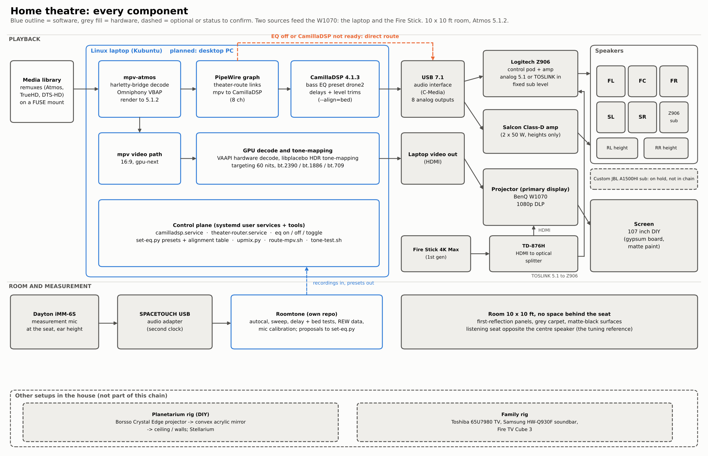
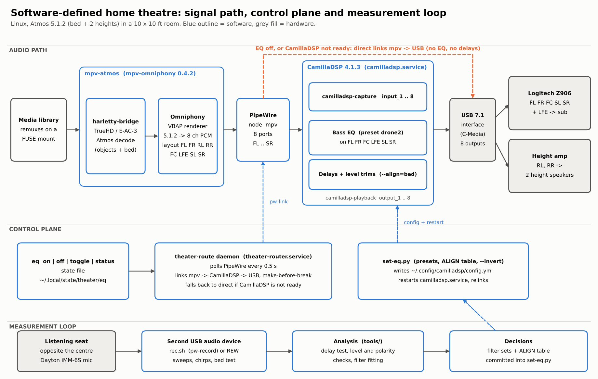
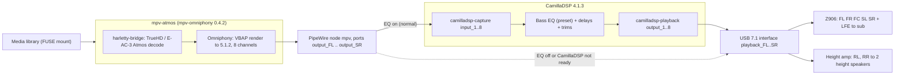
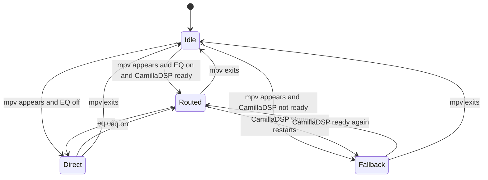
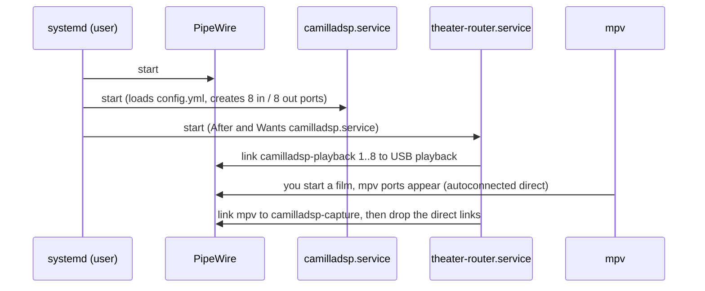

# Architecture

*Every component, hardware and software. Dashed boxes are items to confirm (see [todo-fill-in](todo-fill-in.md)).*

The system has three parts that work together but can be understood separately:

1. **Audio path (data plane):** how sound gets from a file to the speakers.
2. **Control plane:** the small programs that keep the audio path connected and let you change it.
3. **Measurement loop:** how the tuning decisions are made and checked.

## 1. Audio path

Why each stage is there:

| Stage | Why |
|-------|-----|
| **harletty-bridge** | Decodes TrueHD / E-AC-3 Atmos into object metadata plus bed. (Version: v0.9.0 in the new player stack, 2026-10-25; the older stack's build carries no version.) |
| **Omniphony (VBAP)** | Renders objects live to the speaker layout (5.1.2 here). Built from source: `mpv-omniphony` v0.4.2, because the prebuilt binary was broken. |
| **PipeWire** | The graph that connects everything; lets CamillaDSP sit between mpv and the hardware without changing either. |
| **CamillaDSP** | Where all correction lives: bass EQ, per-speaker delay, level trim. Config at `~/.config/camilladsp/config.yml`, generated by `scripts/set-eq.py`. |
| **USB 7.1 interface** | Eight analog outputs, one clock, so relative delays between speakers are trustworthy. |
| **Z906 + height amp** | The Z906 takes five satellites plus sub; the heights have their own amplifier and no sub. |

### Channel map

Hardware order (PipeWire port names on the USB sink; CamillaDSP channel index in brackets, 0-based; CamillaDSP
port number is index + 1):

| Index | Port | Speaker | Goes to | Bass EQ applied | Delay (bed alignment) | Trim |
|------:|------|---------|---------|:---:|--:|--:|
| 0 | FL | front left | Z906 | yes | 0.20 ms | 0 dB |
| 1 | FR | front right | Z906 | yes | 0 (reference) | -1.9 dB |
| 2 | RL | left height | height amp | no | none in `--align=bed` | none |
| 3 | RR | right height | height amp | no | none in `--align=bed` | none |
| 4 | FC | centre | Z906 | yes | 0.97 ms | -0.8 dB |
| 5 | LFE | subwoofer feed | Z906 sub | yes | 0.20 ms | 0 dB |
| 6 | SL | left surround (side) | Z906 | yes | 3.00 ms | -4.4 dB |
| 7 | SR | right surround (side) | Z906 | yes | 2.72 ms | -0.7 dB |

Where the numbers come from: [alignment.md](alignment.md). The Z906 does its own bass management; its sub gets the
low end of all five satellite channels as well as the LFE feed, which is why every Z906-fed channel shows the same
bass in measurements.

### Latency (estimate, not measured)

CamillaDSP runs at 48 kHz with `chunksize: 1024` (21.3 ms per chunk) and the capture node reports
`node.latency = 1024/48000`. Expect roughly one to two chunks of added delay (about 20-45 ms) when routed through
CamillaDSP. That is well inside commonly cited lip-sync tolerances for late audio, and mpv's audio/video sync does
not know about it, so it should be checked by eye once (see [status.md](status.md)). If it ever matters, mpv's
`--audio-delay` compensates.

## 2. Control plane

### theater-route (daemon) and `eq`

`scripts/theater-route` is one file with two faces: run as `theater-route daemon` by the systemd user service, and as
`eq` (a symlink) for you. It polls PipeWire every 0.5 s and applies one rule set:

- **Routed:** mpv ports linked to `camilladsp-capture`, direct links removed.
- **Direct / Fallback:** mpv ports linked straight to the USB sink; CamillaDSP is bypassed (no EQ, no delays).
- **Make before break:** the new links are created and verified before the old ones are removed, so there is no silent
  gap. If anything is missing it keeps or restores the direct route. Silence is the failure it is built to avoid.
- It always keeps `camilladsp-playback:output_N` linked to the USB sink (those links disappear whenever CamillaDSP restarts).
- Works for any channel count mpv exposes (stereo, 5.1, 8): each mpv port is linked to the CamillaDSP input of the same name.

### set-eq.py

Generates the CamillaDSP YAML for a named preset, validates it with `camilladsp -c`, writes
`~/.config/camilladsp/config.yml`, restarts `camilladsp.service`, waits for its ports, relinks, and restores the mpv
route if mpv was routed through CamillaDSP. Presets and the alignment table live in the file (see
[tuning-log.md](tuning-log.md)). `--dry` prints the resulting response without touching anything.

### Boot sequence

## 3. Measurement loop

The microphone sits at the listening seat (opposite the centre speaker) on a **separate USB audio device**, so the
recording clock and the playback clock differ. The methods account for that:
sweeps in REW for frequency response, and a chirp test with a drift-removing fit for timing
([measurement.md](https://github.com/praveenchandrahas/Roomtone/blob/main/docs/measurement.md)). Findings are turned into numbers in `scripts/set-eq.py`, reloaded, and checked
again with a recording. That loop is how every preset and the alignment table were produced.

## Hardware

| Item | Notes |
|------|-------|
| Computer | Linux laptop (Kubuntu). TODO(owner): exact model, kernel, desktop version. A desktop PC build is planned. |
| Video | BenQ W1070 (primary display, 1080p DLP) on a 107" DIY screen (gypsum board with matte paint), 16:9. Two sources: this laptop, and a Fire Stick 4K Max (1st gen) through a TD-876H HDMI to optical splitter, whose TOSLINK feeds the Z906. Video is not otherwise covered by this repo. |
| Interface | Vantec 7.1 USB (C-Media, USB id 0d8c); PipeWire sink `alsa_output.usb-0d8c_USB_Sound_Device-00.analog-surround-71` |
| Bed speakers | Logitech Z906 (5 satellites + sub, analog direct inputs, its own bass management). **Sub level and the knob positions are kept fixed** (see [runbook.md](runbook.md)). |
| Heights | Two speakers (Samsung) on a separate amplifier, no subwoofer |
| Microphone | Dayton iMM-6S with its calibration file, on a SPACETOUCH USB audio adapter (ALSA card 1) |
| Room | 10 x 10 ft, first reflections treated (panels, carpet, matte surfaces) |
| Related builds | Custom subwoofer (JBL A1500HI, 75 L vented, tuned about 24-25 Hz): on hold, not in the signal chain. |

Software versions seen: CamillaDSP 4.1.3, liborender ABI 0.6 (0.3.0, commit 6ffaf21, built 2026-07-24),
mpv-omniphony 0.4.2 (mpv 0.41.0), PipeWire 1.0.5, WirePlumber 0.4.17, REW 5.31.3; harletty-bridge carries no version number. Full table: [installation.md](installation.md#2-player-stack).
