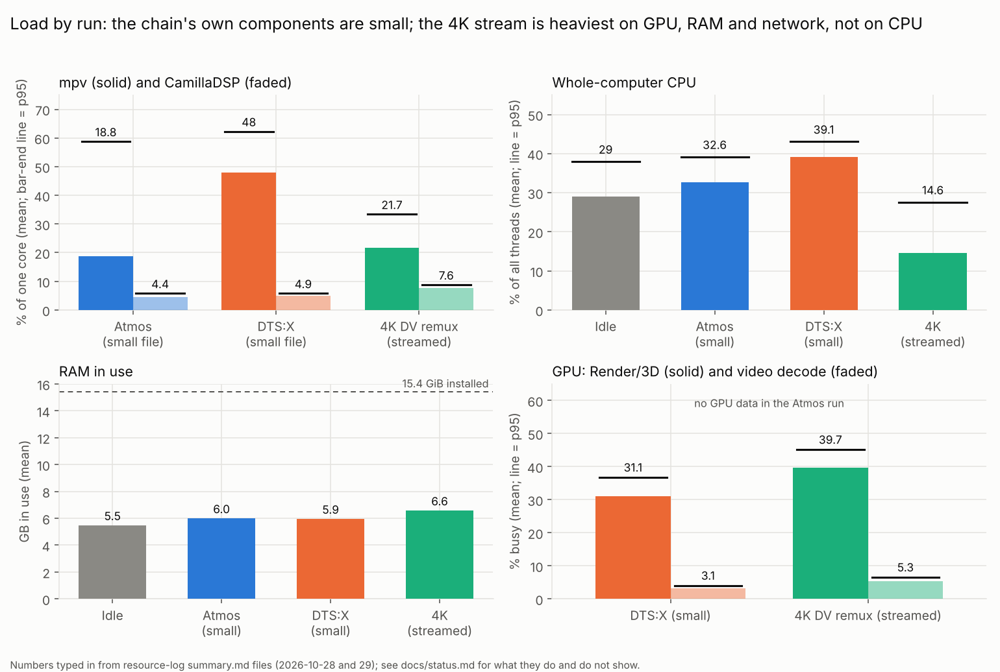
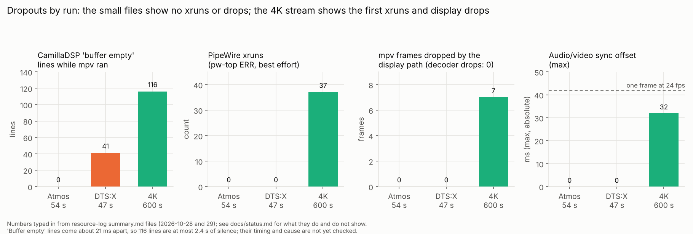
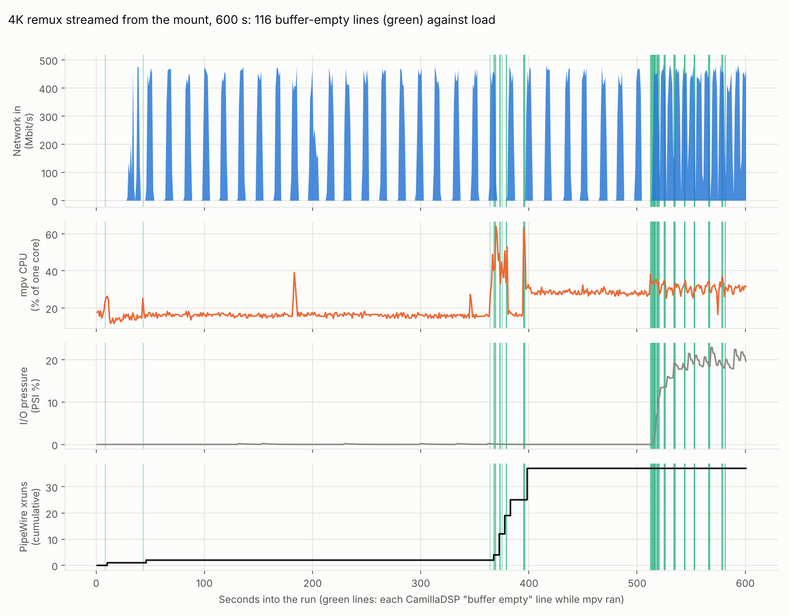
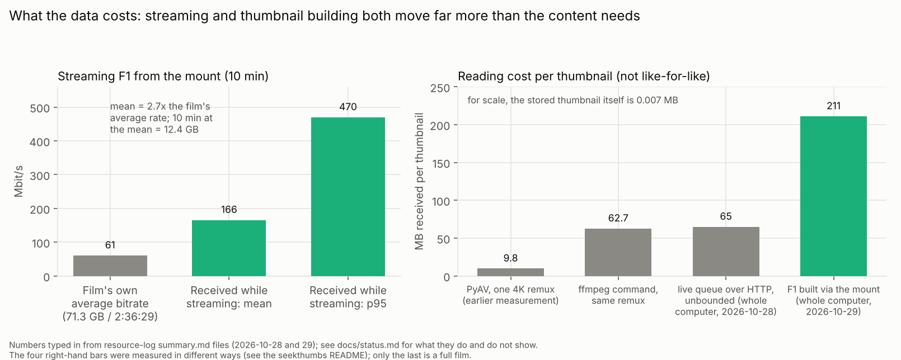
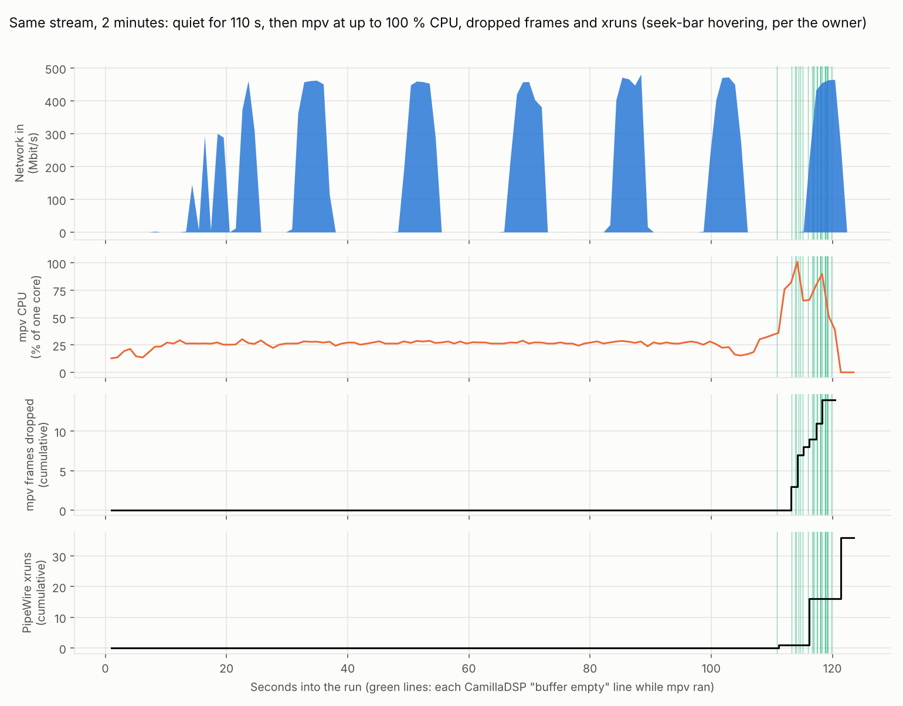

# Status: what is verified and what is not

Updated 2026-10-25. "Verified" means measured **and** confirmed by a recording or by the owner's listening on real material.

| Claim | Evidence | Level |
|-------|----------|-------|
| `drone2` removes the boomy drone and keeps the thump | Recordings at the seat vs no DSP on F1, Godzilla, Tenet; band-energy deltas matched predictions within about 1-2 dB; owner's listening agrees | **Verified** |
| Speaker delays (table in [alignment.md](alignment.md)) are right | Chirp test, two runs (the first discarded for a setup error); after-recordings, then sweep run 1 (2026-10-23, CamillaDSP in the path): the seven full-range speakers arrive within 0.2 ms of FL (the sub, 6-7 ms later, is left uncompensated; see Sub arrival below) | **Verified** |
| All speakers are in phase (no inversion) | Pair test T6, in phase louder for every pair | Measured |
| Level trims bring the speakers to the same level | Sweep run 1: bed speakers within about 2 dB of FL at 500-2k (FR -0.5, SL +0.9, SR +1.7); repositioning the mic moves such numbers by 1-2 dB | Measured (+-2 dB) |
| Heights are bass-managed into the sub and tone-matched to the bed | Sweep run 2 with the profile on: heights + sub within 2.6/2.7 dB rms of the bed over 40-400 Hz (was 41 dB for the heights alone, per bin; about 27 dB with 1/6-octave smoothing); tone deviation 3.1/3.5 dB rms (was 4.5/4.1); heights ran 2-3 dB hot with the first trim, lowered to +1.0 dB (not re-measured) | Measured |
| Sub range | Sweeps at 3 levels: clean to about 40 Hz, usable 36 Hz, audible but 15%+ distortion at 25-31 Hz, nothing usable under 22 Hz; no compression | Measured |
| A rattle/buzz in loud bass scenes | Praveen: it is the sub cabinet rattling at particular frequency/amplitude combinations (heard in the room). Not reproduced by steady tones at -14 dBFS (6-12 dB quieter than the film's bass). Re-analysis of the Amaze recording (fig 18) shows bass hits at 35-65 Hz and no 100 Hz line that stays put across hits, so the clip does not locate the buzz. In the hot run (fig 17) eight tones from 31.5-71 Hz peak at the same recorded level, which points at a limit in the chain; unresolved. Next: the same tone kit at -8/-3 dBFS with hand-on-cabinet checks | Open |
| `mpv-object-audio` (new player stack: engine v0.7.0, bridges v0.9.0, mpv-omniphony main) installs and plays Atmos and DTS:X | 2026-10-25 on the laptop, Vantec **not** connected: installer finished, the new mpv loaded liborender ABI 0.12 0.7.0; the three v0.9.0 bridges (bridge_api 0.6.0, built against Omniphony 55af2c5) loaded and were accepted; the Dolby Atmos TrueHD clip "Audiosphere" (16 PCM channels: LFE direct plus 15 objects) and the DTS:X clip "All Around Us" (12 routed plus 3 object channels) both played with A-V 0.000; owner heard sound | **Verified to play**; routing through CamillaDSP, level against `mpv-atmos` and the rendered layout against the measured one **not yet checked** |
| Level of the new player against `mpv-atmos` | The new engine logs "Dialog normalization: dialogue_level=-23 dBFS -> gain=-8 dB" on the Atmos clip; whether the old engine (0.3.0) did the same is unknown. If not, Atmos films play about 8 dB quieter on the new player and the trims were set against the old level | **Open**: `preflight compare FILE` shows the difference |
| Standing profile (`./make-default.sh`, `eq ensure` in mpv-atmos) survives reboot and starts the services | 2026-10-24 cold boot away from the rig (Vantec not connected): `eq status` = EQ ON, router active, CamillaDSP active with `drone2, bed alignment: yes, heights: bass to sub + tone-match`; `mpv-atmos` started Atmos 8 ch into PipeWire. A later `eq status` showed 0 links, expected with no USB interface | **Services and profile verified at boot**; routing to the rig after a reboot not testable without the Vantec, **still to do at the rig** |
| Auto-routing starts with the system and handles mpv, stereo, 5.1 and 8 channels | Simulated PipeWire graph only (`tests/test_router.py`) | **Not yet tested on the real system** |
| The `eq` switch works mid-film | Simulated only | **Not yet tested** |
| Lip-sync is fine with CamillaDSP in the path | Owner: no lip-sync issue at all on real material; not measured (estimated added delay was 20-45 ms) | Owner-verified (listening) |
| Dialogue is clear and anchored to the screen | Praveen: dialogue is fine. `tools/dialoguetest/` run in the room on 2026-10-24 (dlg1.wav): STI 0.79-0.83, dialogue 13-18 dB above the noise, phantom centre 0.81 vs real 0.79, FC flat to 1.3 dB rms | Measured and owner-verified |
| First-reflection panels (FL, FC, FR, heights) work | `tools/reflecttest/` on sweep run 2 (panels in place, no baseline): FC and FR OK against ITU-R BS.1116 (every reflection 10 dB under the direct sound); FL one reflection at 5.1 ms, -8 dB; both heights a reflection near -1 dB at 3.6-3.8 ms. A/B with panels covered not yet done | Measured (state), **effect untested** |

## Order of work (2026-10-25)

**Now, in this order** (each is quick and tells us what is actually broken):
1. `scripts/preflight` and the reboot test with the USB DAC connected (checks 0-1 below).
2. The bass-rattle hot run ([measurement.md](https://github.com/praveenchandrahas/Roomtone/blob/main/docs/measurement.md); the owner's cabinet diagnosis is recorded above).
3. Vantec checks: whether the optical input and a second digital stream work alongside the 7.1 outputs (`preflight` lists the profiles and sources; `preflight capture SOURCE` is the Fire Stick decode test).
4. Nearfield sweeps of the spare HW-T670 soundbar and its sub (usable band, crossover, distortion), only once 1-3 are done.

**Later**: the second-sub feed (band-limited to about 50-100 Hz; the apartment rules out the JBL; clock drift is checked with `tools/drifttest/`), upmix flavours by ear (checks 6-8), Stremio via an M3U handler for `mpv-atmos` (`eq prepare` must cope with a playlist or URL).

**Parked, no cost to waiting**: 5.1 fly-over detector, SDHT Calibrate (one-command measurement to filters), planetarium sound design (sky-window test on the ceiling comes first), projector automation (RS-232 or IR, lamp-hour log), per-film memory of upmix choices.

## Checks still to do

0. **Run `scripts/preflight` at the rig** (USB DAC connected, ideally after a fresh boot) and send the report. It is read-only: it checks tools, services, the DAC's profiles and inputs, links, xruns, real-time priority and the live mpv options. `preflight --tests` adds the repository tests; `preflight capture SOURCE` is the Fire Stick optical-in decode test. With the new player: `preflight playing` in a second terminal while a film plays (router state, classification, mpv's port names, whether they link into CamillaDSP, mpv's live audio parameters), and `preflight compare FILE` (not read-only: runs `mpv-atmos` and `mpv-object-audio` for 12 s each, muted, and diffs engine version, layout, room ratios, dialogue normalisation and gain).

1. **Reboot test at the rig.** Services and profile came up at boot (2026-10-24, laptop away from the rig). Still to do with the Vantec connected: start a film, run `eq status`, expect "audio goes through CamillaDSP"; then stop CamillaDSP and confirm the direct fallback.
2. **Port names.** The new player logs `AO: [pipewire] 48000Hz unknown8 (empty) 8ch float` (no channel map); `preflight playing` says whether its ports carry the names the router expects (FL FR RL RR FC LFE SL SR) and whether they reach CamillaDSP. While Atmos content plays, then a 5.1 file, record `pw-link -o | grep mpv` in [architecture.md](architecture.md).
   The router handles any port subset, but `route-mpv.sh` reported 8 channels linked while a 6-channel FLAC played: write down why.
3. **Lip-sync.** Watch a clear-speech clip with `eq on` and `eq off`; adjust `--audio-delay` if a difference is visible.
4. **Alignment proof.** The bed-off versus bed-on recording in [measurement.md](https://github.com/praveenchandrahas/Roomtone/blob/main/docs/measurement.md#proof-of-the-alignment-still-open).
5. **Real films.** A few non-trailer films (dialogue-heavy, quiet) with the final settings.
6. **Upmix by ear.** Measured offline only. At the rig: a YouTube clip (speech, then music) in `stereo:voice|balanced|wide`, and a 5.1 film in `bed:subtle|balanced|wide`; note the flavour you prefer. 
7. **Automatic profile at the rig.** (a) Play a YouTube video in Chrome: `eq status` should show "Google Chrome: playing, 2/2 channels patched" and `Profile: stereo:balanced`; if it says nothing about Chrome, send `pw-link -o | grep -i chrome`. (b) Start an Atmos film, then a 5.1 file, then a stereo file with `mpv-atmos`: `eq source` and `eq status` should say film / bed / stereo. (c) Chrome playing while a film starts: the film wins and Chrome must go back to normal sound (untested: relies on WirePlumber re-linking it). (d) Plain `mpv` needs `input-ipc-server` in mpv.conf.
8. **Adaptive engine at the rig.** Never run against real PipeWire (the DSP, latency and CPU are tested offline only). Re-run `install-autoroute.sh`, play a YouTube video, then `eq status`: expect "Adaptive engine: on, service active, ports up, linked into CamillaDSP" and `Profile: stereo-ad:balanced`. Unverified: the pw-cat flags and port names (`theater-upmix-in:input_FL`, `theater-upmix-out:output_AUX0..3`; check with `pw-link -io | grep theater`), whether the engine gets real-time priority (watch for clicks in the rear/ceiling feeds; `journalctl --user -u theater-upmix`), and the real end-to-end delay of the rear feeds (the sweep tools can measure it). If it falls back to the fixed matrix, send me `journalctl --user -u theater-upmix -n 30`. Judge adaptive vs fixed by ear: `eq engine off` / `eq engine on` mid-clip.
9. **DTS:X as objects.** A DTS:X clip played with sound on 2026-10-25 (USB interface not connected), which does not show it was decoded as DTS:X. Check: `ffprobe -v error -select_streams a -show_entries stream=codec_name,profile,channels -of csv FILE` should name DTS-HD MA with DTS:X in the profile (a file name that says DTS:X is not proof); play it with the new player and confirm the overlay shows the 7.1.4 channels; note which layout the engine log reports.
10. **CPU, RAM, GPU and dropouts during a film.** Measured 2026-10-28 (two small files) and 2026-10-29 (a 4K Dolby Vision remux streamed from the mount for 10 minutes); results in [Resource log, 2026-10-28](#resource-log-2026-10-28) and [Resource log, 2026-10-29](#resource-log-2026-10-29-4k-remux-streamed-from-the-mount) below. The 116 buffer-empty lines and 37 xruns in the 4K run were lined up by time on 2026-10-29 (see that section): none in the first 6 minutes bar two isolated ones, then two clusters, one of them seeks and one hovering over the seek bar. A repeat run reproduced the hover stutter (mpv at 100 % CPU, 14 drops, 16 xruns after 110 s clean); the viewer was changed to send fewer updates, untested on the rig. Still to do: the same run with the new viewer, a longer run, a repeat idle run, and a check of the buffer-level probe.

## Resource log, 2026-10-28

Three runs of Roomtone's `scripts/resource-log`, 1 s samples, at about 15:40 to 15:45 IST: `atmos` (52 samples with mpv running, about 54 s), `idle` (117 s, nothing playing) and `dtsx` (45 samples with mpv running, about 47 s). One small local file, so no network reading and not a 4K HDR remux; this is a first look, not a worst case. End-to-end latency was not measured.

| What | Result |
|---|---|
| Clipping, PipeWire xruns | 0 and 0 in all three runs (xruns are best effort in the script) |
| CamillaDSP load | mean 2.8 to 3.7 %, max 4.2 % |
| Buffer-empty lines while mpv ran | Atmos 0; DTS:X 41 (about 21 ms apart, so under one second in total; whether they fell at the start, before audio began, or mid-film is not yet checked) |
| mpv frames | 0 dropped, delayed or mistimed in both film runs |
| mpv CPU | Atmos mean 18.8 % of one core (max 66 %); DTS:X mean 48 % (max 63 %); the rest of the chain a few percent |
| RAM in use | 5.5 GB idle, 5.9 to 6.4 GB while playing (mpv about 450 to 540 MB) |
| Temperature | mean 54.6 to 55 C, max 61 to 62 C, no thermal throttle |
| GPU (DTS:X run only) | Render/3D 31 % mean, video decode engine 3 %, 1.1 W; the Atmos run recorded none |
| Network | about 0 Mbit/s (local file) |

Things this does not show, and what looks off:

- **Two probes never moved in these first runs.** CamillaDSP buffer level read 0 and mpv A/V sync read exactly 0.0 ms. The A/V sync probe did move in the 4K run on 2026-10-29 (up to 32 ms), so it works. The buffer-level probe still read 0 in every run, including the one with xruns, so it is still unconfirmed. Check: run a deliberate load (for example `stress-ng --cpu $(nproc) --timeout 60s`) during playback and see whether it moves.
- **The idle computer was busy.** Idle whole-computer CPU averaged 29 % while the listed components added up to a few percent of one core, so most of it was unattributed. The 4K run the next day, with the film playing, averaged only 14.6 %, so the 29 % was probably transient work on that day (the thumbnail queue and the failing mount are candidates; not shown).
- **I/O stalls differ between runs.** Mean I/O pressure (PSI) was 48 % (atmos) and 36 % (idle), nearly flat, then 2 % in the DTS:X run two minutes later and 2.6 % in the 4K run the next day. A flat value looks like one task waiting on I/O the whole time (a guess: a process stuck on the Decypharr mount, which was failing that day), not varying load. Not explained; a repeat idle run with the mount working would help.
- **A warning about once a second** ("Lost connection: WebSocket protocol error") comes from theater-ctld's connection to CamillaDSP, which closes without a close frame. Harmless, but it inflates the warning counts. A fix is not applied.
- **Idle CamillaDSP** logs "buffer empty" about every 21 ms (47 per second, 5,633 in 120 s); the script counts these separately for the time mpv is not running.
- **GPU data is intermittent.** The Atmos run used `--gpu-sudo` and got none; the DTS:X run got it. Run `sudo -v` immediately before the log. Plain `intel_gpu_top` without root aborts on this machine with an assertion in `get_num_gts`.

## Resource log, 2026-10-29 (4K remux streamed from the mount)

One run of 600 s (583 samples) on 2026-10-29 at 09:58 IST: a 71.3 GB 4K Dolby Vision HEVC remux (2 h 36 min, Atmos TrueHD) played from the Decypharr mount, hardware decoding through VAAPI. The seekthumbs process was not running (per the run's process table). This is the first run with a real 4K file and the first with a full 10 minutes. Figures: [load by run](graphs/21_resource_load_by_run.png), [dropouts by run](graphs/22_resource_dropouts_by_run.png), [data cost](graphs/23_stream_and_thumbnail_cost.png) (drawn from numbers typed in from the summaries, by `tools/make-resource-graphs.py`), and [the run over time](graphs/24_4k_run_over_time.png) (drawn from the run's own samples, by `tools/make-resource-timeseries.py`).

| What | Result |
|---|---|
| mpv CPU | mean 21.7 % of one core, p95 33 %, max 64 %; mpv RSS 1,020 MB mean, 1,162 MB max |
| CamillaDSP | CPU mean 7.6 %; processing load mean 4.2 %, p95 5.9 %, max 12.5 % |
| Whole computer | CPU mean 14.6 %, p95 27.6 %; RAM in use 6.6 GB mean, 6.8 GB max |
| GPU | Render/3D 39.7 % mean (p95 45 %, max 56 %); video decode engine 5.3 % mean (max 10.8 %); 3.3 W; clock mean 498 MHz |
| Temperature | mean 51 C, max 65 C, no throttle events; CPU clock up to 4.0 GHz |
| Network received | mean 166 Mbit/s, p95 470, max 493 |
| mpv frames | 7 dropped by the display path, 0 by the decoder, 0 delayed or mistimed; A/V sync mean 0.2 ms, max 32 ms (a frame at 24 fps is 41.7 ms) |
| Stalls (PSI) | CPU mean 1.4 %; I/O mean 2.6 %, p95 19.7 %, max 22.9 %; memory 0 % |
| Audio | clipping 0; **PipeWire xruns 37** (best effort); **116 CamillaDSP "buffer empty, outputting silence" lines** |

What it shows, and what it does not:

- **Decoding and rendering are not the limit.** The decoder dropped nothing, the video decode engine was at about 5 %, and CPU use was lower than in the small DTS:X run. The 4K file is heavier on the GPU's render engine, RAM (mpv about 1 GB) and the network, not on the CPU.
- **These are the first xruns and the first display drops in any run, and they are not spread evenly.** Lined up by time with `samples.csv`, `camilladsp-journal.txt` and `pw-top.log` (run start taken as 09:58:41, so times are good to about 1 s; the slimmed data is in `docs/data/`, figure below):
  - **0 to 364 s: clean.** Two isolated buffer-empty lines (at 8 s and 43 s) and one xrun at each of 10 s and 46 s. Six minutes of otherwise uneventful playback with the network arriving in bursts of about 450 Mbit/s for 5 s every 13 s.
  - **364 to 398 s: the xrun cluster.** 24 buffer-empty lines and 35 of the 37 xruns (steps of 2, 8, 7, 6 and 12 at 368, 373, 378, 383 and 398 s), plus 6 of the 7 display drops (3 at 370 s, 1 at 378 s, 3 at 396 s). mpv's CPU rose from 16 % to 40 to 64 % at the start of it, and the network went silent for 10 s in the middle (370 to 380 s) while mpv kept using CPU. The whole computer's CPU (not above 32 %), temperature and the audio daemons' load did not show anything. Afterwards mpv's baseline CPU stayed at about 30 %, against 16 % before.
  - **512 to 581 s: the buffer-empty cluster, with no xruns.** About 90 lines in 70 s, no new xruns, no drops. At 512.4 s mpv's drop counter reset (7 to 0) and the A/V sync probe read -32 ms once (and -15 and -12 later), while mpv's memory kept growing without a reset. A counter reset like that normally means a new file or a seek, but the files do not say which. From 514 s the I/O pressure climbed from 0 to 20 % and stayed there, and the network bursts came closer together (every 9 s instead of 13 s).
  - **Which node had the xruns** (the last value per node in `pw-top.log`; they add up to 37): mpv's audio stream 25, the USB sound device's output 11, CamillaDSP's capture 1. The mpv side dominates, which fits mpv missing its deadlines while its CPU spiked, rather than the output device failing alone.
  - **What this does not show.** Correlation in time, not cause. It does not say what was happening on the screen (a seek, a track change and a pause would all look like this). It does not say whether anything was audible: 116 lines at 21 ms apart is at most 2.4 s of silence in total, in about 30 separate seconds, and a gap of one 21 ms chunk may or may not be heard. The second cluster, with no xruns recorded, is the least explained: CamillaDSP logs the same line whenever its input runs dry, including when nothing is playing, so those lines could be a pause, a seek or a starved input. The buffer-level probe read 0 throughout, so it gives no help.

- **The network pull is about 2.7 times the film's own bitrate.** The file averages about 61 Mbit/s (71.3 GB over 2:36:29); the run received 166 Mbit/s on average, which is 12.4 GB in 10 minutes, against about 4.6 GB at the film's average rate. The counter covers the whole computer, and the first minute may include a start-up burst, so the true steady-state ratio is unknown. If it held for a whole viewing it would be roughly 190 GB through the mount for one film, which is relevant to any daily traffic cap. Not yet checked against Decypharr's own Daily Usage figure.

- **Building thumbnails costs far more than they weigh.** The same day, the on-play build of the same film (469 thumbnails, read through the mount with 2 parallel reads, 38 minutes) received 98,945 MB, or 211 MB per thumbnail, for a 3.27 MB result. The mount's read-ahead (128 MB, chunks of 8 MB) is the suspect, not confirmed. At about 99 GB a film, the 452 GB of daily usage Decypharr showed on 2026-10-28 is roughly 4.5 films. Not yet measured: the same build over HTTP with the bounded reader, and with a smaller read-ahead.
- **Owner's account (2026-10-29, after the run):** the events were him hovering over the seek bar to test the seekthumbs thumbnails (they worked), and he noticed an A/V stutter at the time. A second run the same morning (below) reproduced it.
- **Second cluster, by the owner (same day):** at 512 to 581 s he made a few seeks inside mpv's cached part: the step is 10 s per key press, and he pressed enough at once to jump 20 to 30 s. (An earlier version of this note read it as 20 to 30 seeks and worked out 3 to 4 lines per seek; that was wrong.) Each seek flushes mpv's audio, so CamillaDSP's input runs dry and it logs "buffer empty". The 90 lines fall in 7 episodes: 512 to 520 s (41 lines), then about 8 to 9 lines each at 525, 534, 544, 553, 566 and 578 to 581 s, spaced 9 to 13 s apart. About 9 lines is roughly 0.2 s of silence if the lines are 21 ms apart; the first, longer episode may be several seeks close together. This fits the lack of xruns (nothing missed a deadline) and the A/V sync blips at 512, 517, 526 and 527 s, but the seek times were not logged, so the episodes are matched to seeks by count and plausibility only (a 9 to 13 s spacing also resembles the network burst cadence, so seeks about every 10 s and something tied to the bursts cannot be told apart without times). A seek gap is expected behaviour, not a dropout. Not shown: that the 512 s counter reset was a seek, and that the 20 % I/O pressure and closer network bursts from 514 s were caused by the seeks (plausible, since mpv refills its cache after a seek). Consequence: buffer-empty lines during a seek should be counted separately from lines in steady playback.
- **Not established:** that the first cluster was the hovering in this run (it was in the repeat run, below), and whether either cluster was audible beyond the stutter he noticed; a longer run; the buffer-level probe; anything about latency. The I/O pressure of 20 % from 514 s to the end of the run, with the network bursts closer together, is also unexplained (the seekthumbs process was not running; Decypharr's read-ahead is a suspect, not tested).

## Resource log, 2026-10-29 10:44 (hover test, 2 minutes)

A repeat of the same stream, 120 s, started 10:44:33 IST, run after the owner reported that hovering over the seek bar to look at the thumbnails stuttered. GPU not measured (`--gpu-sudo` was not used), seekthumbs not running, ffmpeg processes not tracked. Data in `docs/data/resource-log-20261029-hover-*`; figure: [the run over time](graphs/25_hover_run_over_time.png).

- **About 110 s with nothing wrong, then a burst of trouble.** From 0 to 110 s: no xruns, no dropped frames, no buffer-empty lines, mpv at a steady 26 % of one core (mean 25.7 %, max 30), the network arriving in six bursts of about 450 Mbit/s. From about 111 s: mpv's CPU went to 76 %, 82 %, **101 %**, 66 %, 66 %, 80 %, 90 % over the next 7 samples; 14 frames were dropped by the display path (none before); 16 xruns in the first 10 s (1 at 111 s, 15 at 116 s); 24 CamillaDSP buffer-empty lines between 110.8 s and 119.8 s, spread out as separate holes (not a continuous run). The decoder dropped nothing. Whole-computer CPU stayed at 45 % or below.
- **The order matters.** mpv's CPU rose (to 76 %) at 112 s, two samples before the seventh network burst began (114 s). The six earlier bursts, of the same size and each lasting about 5 s, caused no drops, no xruns and no lines. So the network burst is not enough to cause it, and the data does not support the earlier candidates of I/O pressure and bursts for this event (I/O pressure stayed at 0.2 % or below throughout).
- **What the files do not show:** the mouse. The hover times were not logged, so "hovering started at about 111 s" is read from the data and agrees with the owner's account, not with a record of the hover. 20 more xruns appear at 121.4 s, when mpv closed; that is teardown, not stutter, and the summary's 36 includes them (16 while playing). The 117 buffer-empty lines after mpv stopped are the idle ones.
- **What the code does (checked in `thumbfast.lua`, with the old version run under the test harness).** On every mouse move uosc sends a `thumb` message (a hundred or more a second). The old viewer answered each with `overlay-add`, which makes mpv read the picture again and redraw, even when the picture and place had not changed (300 moves in 0.3 s gave 301 overlays), and started one ffmpeg per new picture (a sweep over 14 pictures gave 14 at once). That work is on mpv's main thread, which also feeds the audio, at a quantum of 21 ms. This matches mpv at 100 % of a core with audio underruns, but **which part costs the most is not measured**: the overlay redraws, the OSC's own drawing while hovering, the ffmpeg starts, or something in uosc. The CPU of the ffmpeg children is not in the `mpv` column.
- **Change made (seekthumbs, `thumbfast.lua`):** send an overlay at most every 40 ms and only when the picture or its position changed; at most 2 conversions at once, the newest wanted one next, the ones the mouse passed are skipped; the overlay appears where the mouse is now; a conversion that ends after another film was loaded is dropped. Tested with a mocked mpv (300 moves give at most 10 overlays; a fast sweep starts at most 2 conversions and makes 3 of 14). **Not yet tried in mpv on the rig**, so whether the stutter is gone is open.
- **Next measurement:** the same 2-minute run with the new `thumbfast.lua`, a hover sweep of known length and the clock times written down, `--gpu-sudo` for the GPU, and the `ffmpeg` column (`scripts/resource-log` now tracks it). If the stutter remains, take the viewer out (`seekthumbs.py` removes it with `uninstall-viewer` or rename it) and hover again: that tells whether the cost is in this script or in uosc.

## Resource log, 2026-10-29 11:21 and 12:38 (hover tests after the viewer change)

Two retests after the `thumbfast.lua` change, both with `--gpu-sudo`, the same 4K stream, seekthumbs not running. **A mistake in my instructions makes both inconclusive about the change:** I told the owner to `git pull` in seekthumbs and restart mpv, but `seekthumbs.py install-viewer` *copies* `thumbfast.lua` into `~/.config/mpv/scripts`, so a pull alone leaves the old script running. Whether he re-ran `install-viewer` is not known. Check: `grep -c MAX_CONV ~/.config/mpv/scripts/thumbfast.lua` prints 1 or more only for the new script.

- **11:21 run (67 s, "hover-new"):** CamillaDSP was not carrying audio (66 "Capture: waited 1s but only got 0 bytes" lines, load 0.0 %, no buffer-empty lines), so only the video side counts: 28 frames dropped by the display path, mpv mean 40 %, p95 87 %, max 103 %, I/O pressure up to 14 %, 99 xruns on some node (not identified; no data files were sent). Cause of the missing audio not known.
- **12:38 run (64 s, "hover-new-with-camilladsp"; data in `docs/data/resource-log-20261029-hover2-*`, [figure](graphs/26_hover2_run_over_time.png)):** CamillaDSP carried audio (load 4 %). 0 to 34 s clean (mpv 25 % mean, max 31 %; no drops or xruns), matching the owner's "no hover for the first 20 s" and showing nothing wrong until 35 s. From 35 s mpv's CPU rose to 52, 62, 67 % and from 45 s sat at 93 to 142 % (mean 108 % over 44 to 64 s); the display path dropped 80 frames (the first at 45 s); 241 xruns (8 at 41 s, then 24, 76, 59, 74 in 5 s blocks; mpv's stream 174 and the USB output 73 as the last values per node in `pw-top.log`, which sum to 247 against the summary's 241); 198 buffer-empty lines between 35 and 64 s, about 10 a second from 45 s to 62 s (74 more in the first 2 s are the idle kind, before audio started); A/V sync up to 11.8 ms; the decoder dropped nothing. **The owner confirms the stutter was still there.**
  - **The network did not drive it:** nothing was received from 21 s to 44 s, and mpv's CPU had been rising for 10 s when the one burst of the run began (45 s).
  - **The GPU did not peak:** render busy mean 41 % (max 54 %), the same as the 40 % before the hover; video decode 5.6 %; clock up to 702 MHz. Whole-computer CPU max 60 %.
  - **No sign of improvement, but not a test of the change.** Per second of hover this run is no better than the 10:44 run (80 drops in about 20 s of trouble against 14 in 9 s; 241 xruns against 16), and the hover was probably longer and harder, so the two are not comparable either way. If the stale copy was running, this run is the old viewer again; if the new one was running, the diagnosis in the 10:44 section (overlay updates and ffmpeg starts) was not sufficient. **That diagnosis was a reading of the code, not a measurement of where mpv's time goes.**
- **Where mpv's time may go instead (not tested):** uosc redraws its own interface on every mouse move over the timeline (an overlay mpv has to composite), and a redraw of a 4K Dolby Vision frame through the renderer may be costly independent of our script. mpv at more than 100 % means more than one thread is busy (for example the video output thread as well as the main one).
- **Next, in this order:** (1) `cd ~/sdht-workspace/seekthumbs && git pull && python3 seekthumbs.py install-viewer`, confirm with the `grep` above, restart mpv, repeat the run with the hover times written down; (2) if it still stutters, move `~/.config/mpv/scripts/thumbfast.lua` away (uosc still draws its time tooltip, no picture) and hover again: if it still stutters, the cost is in uosc or mpv's drawing, not our script; (3) the same hover on a 1080p non-Dolby-Vision file, to see whether the 4K Dolby Vision frame is the amplifier; (4) if the cost is uosc's, try mpv's stock OSC or uosc with its timeline preview off.

## Sub arrival (measured 2026-10-24 from sweep1/sweep2)

The sub (LFE) arrives about 6 to 7 ms after the front left at the seat, with a group delay near 15 ms at 50 to 100 Hz. The LFE delay is still 0.20 ms (kept in step with FL), so this has not been compensated.

**Is it audible as a delay? Judged no, at this seat.** This is a judgement from the numbers and published thresholds as the author knows them, not a listening test, and it rests on one seat and sweep-derived figures.
- 6 to 7 ms is about 2 m of path. For bass below about 100 Hz it is not heard as a separate event: low frequencies cannot be localised, there is no echo, and the delay thresholds known for 50 to 100 Hz material are in the tens of milliseconds, above the 15 ms group delay here.
- Being a few feet from every speaker does not change this. The offset is the sub's own latency (filters, port, amplifier) as measured at the seat, not a distance effect, and the small room makes the satellite-to-satellite spread negligible (within 0.2 ms).
- Not settled by that argument: how the sub and the bed add around the crossover. At 60 Hz one period is 16 ms, so 6.5 ms is about 0.4 of a cycle; at 80 Hz it is about half a cycle, which is the worst case for cancellation where both are playing. That shows up as a dip or bump in the measured response (heights + sub were within 2.6/2.7 dB rms of the bed over 40-400 Hz), not as lateness. Whether delaying the bed or flipping polarity improves the summation is open; judge it by a sweep and by ear.
- To confirm by ear: play a kick drum or the LFE test clip with the bed delayed by 6.5 ms and then not, level-matched; if you cannot tell them apart the delay is irrelevant to you.
