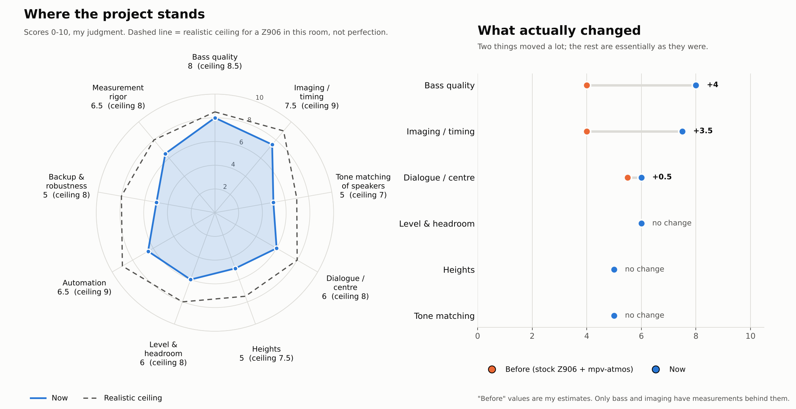
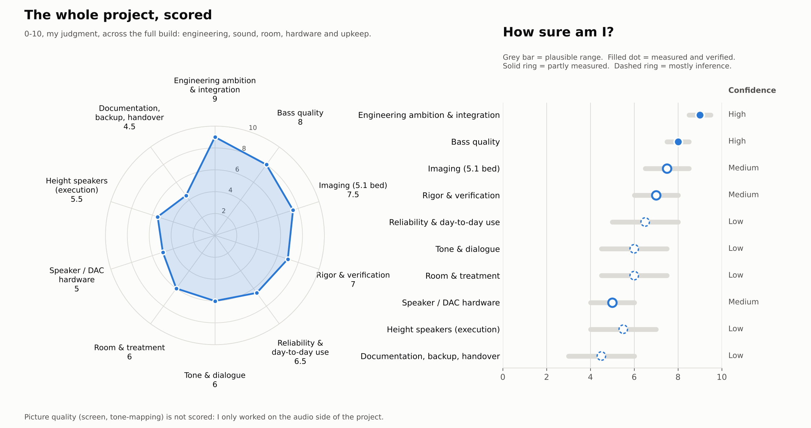

# A software-defined 5.1.2 home theatre on Linux

Technical writeup, 21 October 2026. Compiled from the repository, the tuning sessions of 19 to 21 October, and the earlier conversations that built the system (July to October 2026). Facts taken from older conversations are dated by the conversation; where those conversations disagree with each other, the disagreement is stated.

## 1. Summary

A laptop plays Dolby Atmos remuxes through a patched mpv. The object audio is decoded and rendered live to a 5.1.2 speaker layout, passed through a parametric EQ and per-channel alignment stage, and sent out of an 8-channel USB interface to a Logitech Z906 (five satellites and a sub) plus two ceiling height speakers on a separate amplifier. The picture goes to a BenQ W1070 projector on a 107 inch screen the owner built from painted gypsum board. The room is a treated, light-controlled room of roughly 10 x 10 ft.

Nothing in the chain is a receiver or a processor sold for the purpose. Every stage is software the owner configured, and every tuning decision was checked against recordings made at the listening seat.

## 2. System overview

Blue outline is software, grey fill is hardware. The orange path is the fallback: when EQ is switched off or CamillaDSP is not ready, audio goes straight to the interface.

## 3. Hardware

| Part | What it is | Source of the fact |
|------|-----------|--------------------|
| Computer | Kubuntu laptop, 11th-gen Intel i5, Iris Xe graphics. A desktop (Ryzen 7 5700X, B550M, used RTX 3060 12 GB) is planned | Conversations, Jul and Aug 2026 |
| Audio interface | Vantec 7.1 USB (C-Media CM6206 class), 8 analog outputs. Analog 7.1 mode; the optical output can leak in some modes | Conversation, Aug 2026 |
| Bed speakers | Logitech Z906: front L/R, centre, two surrounds, sub. Fed through its multichannel analog input | Repository |
| Height speakers | Two Samsung SWA-8500S speakers (the wireless surrounds of a Samsung HW-T670 soundbar system, now wired), on the ceiling, driven by a Salcon Class-D 2 x 50 W amplifier, no sub | Owner, 22 Oct 2026 |
| Custom subwoofer | JBL A1500HI in a 75 L vented box tuned to about 24-25 Hz, Salcon Class-D 500 W amplifier. **On hold**, not in the signal chain | Conversation, Jul 2026 |
| Projector | BenQ W1070, 1080p DLP, about 2,700 lamp hours in Aug 2026 against a rating near 3,500. Relamp planned for 2027 | Conversations, Aug 2026 |
| Screen | 107 inch 16:9, gypsum board, sanded and sprayed with Asian Paints Royale Glitz Ultra Matt base white, matt black painted border, later extended with a 4 inch black velvet border. Measured about 2.38 x 1.34 m | Conversations, Jul and Aug 2026 |
| Second source | Fire Stick 4K Max (1st gen) into a TD-876H HDMI to optical splitter, HDMI to the projector, TOSLINK to the Z906 | Owner, 21 Oct 2026 |
| Measurement | Dayton iMM-6S microphone on a separate SPACETOUCH USB adapter (a second clock), REW | Repository, conversations |
| Other projector | Borsso Crystal Edge, ceiling-mounted beside the W1070 and used for a DIY planetarium rig. Not part of the tuned chain | Conversations, Jul and Aug 2026 |

## 4. The room

(photo slot: room, screen wall)

The room photographs shared in earlier conversations could not be retrieved into this document; only Claude's written analyses of them survive. Add the photos in the marked slots. What those analyses recorded:

- Matte charcoal and navy on the walls and ceiling, black and grey matte elsewhere, grey carpet, a shag rug.
- First-reflection panels on standoffs with an air gap, on both side walls (the right side was finished last).
- Patchwork treatment near the screen (woven grey fabric panels), the desk (pyramid foam) and the chalkboard wall (glossy black panels), described as iterative rather than one design pass.
- Two projectors on the ceiling and a wall shelf bracket. Flagged risks in the Aug 2026 review: a ceiling fan, an AC unit near the projector mount, an untreated quilted blind wall, a glossy wood door.

**Dimensions disagree.** Conversations give 10 x 11 x 10 ft, 11 x 12 ft and (for this repository) 10 x 10 ft. The tuning used 10 ft. The first axial mode of a 10 ft dimension is near 56 Hz, and the measured seat response peaks at 56 to 68 Hz with a null near 72 Hz, which is consistent. Measure the room and fix this.

**Why 5.1.2.** The seat is against the back wall, so there is no space for rear surrounds or rear heights. A 5.1.4 or 7.1.4 layout was ruled out in August 2026 for that reason.

## 5. How the audio chain was built

| When | What happened |
|------|---------------|
| Jul 2026 | Cavern/Cavernize used as an offline renderer: Atmos to a baked 5.1.2 WAV. Real-time Atmos decode was confirmed impossible in Cavern on Linux. |
| 21 Jul | Height channels reached the DAC silent. Cause: mpv negotiated plain 7.1 with the ALSA sink, which has no meaning for top channels, so ffmpeg dropped channels 7 and 8. Fixed with an index-based `channelmap` filter, verified by rendering mpv's PCM to file and measuring per-channel peaks. |
| 24 Jul | Research found Omniphony (VBAP object renderer, Rust) and harletty-bridge (TrueHD and E-AC-3 Atmos decode). DTS:X is not covered. |
| 10 Aug | The prebuilt mpv-omniphony 0.4.2 binary had no PipeWire, ALSA, X11 or Wayland backends. Rebuilt from source against mpv 0.41.0 (24 orender patches applied). A GitHub issue was filed. |
| 10 Aug | First live run: Omniphony Studio showed 16 object trails, LFE routed direct, PipeWire output 48 kHz, 8 channels float. |
| Aug to Sep | `mpv-atmos` wrapper written: VAAPI decode, gpu-next on Vulkan, tone-mapping tuned to 60 nits for the projector, overlay toggle script. A packaging bug in Omniphony's virtual bed layout paths was reported upstream and merged. |
| 19 to 21 Oct | CamillaDSP placed between mpv and the interface; bass voicing, alignment and auto-routing (section 7 to 9). |

### Signal chain

The audio path runs mpv, then PipeWire, then CamillaDSP (48 kHz, chunk 1024), then the USB interface. Hardware channel order is FL, FR, RL, RR, FC, LFE, SL, SR on indexes 0 to 7. A router daemon links mpv's outputs to CamillaDSP's inputs and falls back to a direct route.

### Picture chain

`mpv-atmos` uses `--vo=gpu-next --gpu-api=vulkan`, VAAPI hardware decode, `--target-prim=bt.709 --target-trc=bt.1886 --target-peak=60 --tone-mapping=bt.2390`, a Mitchell downscaler with linear, corrected downscaling, and debanding. The 60 nit target came from measuring the projector's real output. A Dolby Vision check found mpv applying the DV colour matrix, and the test files were profile 7.6 MEL.

## 6. Bass tuning

The Z906 hands every channel's bass to its sub, so all six Z906 channels share one large bass hump below about 100 Hz. Peaks sit near 60 Hz, 30 to 35 dB above the mids. The heights are 25 to 45 dB lower below 90 Hz.

A flat correction sounded lean and hollow, so the target was a deliberate hump with the drone note removed. Cuts only, never boosts, because a null cannot be filled by EQ.

The preset `drone2` is eight narrow cuts (47, 61, 85, 107, 142, 155, 177, 250 Hz, Q about 5) plus two extra: 72 Hz at -6 dB (Q 8) and 84 Hz at -6 dB (Q 4). In the F1 title music the drone sits at 63 to 92 Hz and the thump at 56 to 63 Hz, so a static cut separates them.

Checks: recordings at the seat against no DSP on F1, Godzilla and Tenet. Band-energy changes matched predictions within about 1 to 2 dB wherever the microphone did not clip. The owner confirmed the result by listening.

## 7. Alignment

Chirp trains were recorded at the seat on a second clock, and delays were solved by least squares to remove drift. Polarity was checked with a pair test and found correct on all channels.

| Ch | Delay (ms) | Trim (dB) | Ch | Delay (ms) | Trim (dB) |
|----|-----------:|----------:|----|-----------:|----------:|
| FL | 0.20 | 0 | SL | 3.00 | -4.4 |
| FR | 0.00 | -1.9 | SR | 2.72 | -0.7 |
| FC | 0.97 | -0.8 | RL | 4.60 | -0.6 |
| RR | 4.70 | -0.3 | LFE | 0.20 | 0 |

The surrounds are about 1 m closer to the seat than FR, the farthest speaker (SL 1.03 m, SR 0.93 m closer), so they take the largest bed delays. The heights are left out of the applied alignment (`--align=bed`).

## 8. Automation

`linux-theater-dsp` is a user service that watches the PipeWire graph every 0.5 s and links any mpv output to CamillaDSP, make-before-break, with a direct fallback. `eq on|off|toggle|status` switches the DSP in or out; off is a full bypass, including delays and trims. The behaviour is covered by 35 simulated tests.

## 9. Project assessment

Strengths: ambition and integration, measurement discipline, honest documentation. Weakest areas: validation on the real machine and single-seat tuning.

## 10. What is verified and what is not

| Claim | Level |
|-------|-------|
| `drone2` removes the drone and keeps the thump | Verified (recordings plus listening) |
| Delays correct, speakers in phase | Measured |
| Level trims equalise the speakers | Partial: post-trim check inconclusive |
| Auto-routing at boot, `eq` switch mid-film | Simulated only |
| Lip-sync with CamillaDSP in the path (estimated 20 to 45 ms) | Not tested |
| Dialogue clarity and screen anchoring | Not tested |

## 11. Open items

1. Reboot test of auto-routing on the real system.
2. Lip-sync check with `eq on` and `eq off`.
3. Confirm room dimensions and the laptop to projector HDMI path. The JBL sub is on hold.
4. Relamp the W1070 (planned 2027); the grey-cloud degradation seen in 2026 is lamp related.
5. Height-channel high-pass and alignment (low priority; tone matching of the Samsungs was declined for now).
6. Add the room photographs and push the repository to GitHub.

## Sources

Repository docs in this folder, and these conversations (all dated 2026): Creating mpv-atmos command with Omniphony (8 Sep); Linux Atmos players with 3D audio preservation (10 Aug); Spatial audio lab Linux movie replication (24 Jul); Configuring 5.1.2 surround with Cavernize and USB DAC (21 Jul); Cavern realtime DDP to 5.1.2 (14 Jul); JBL A1500HI low frequency capability (29 Jul); DIY painted screen vs commercial projector screen (26 Jul); Setup analysis and feedback (14 Aug); Feedback request (20 Aug); Projector upgrade within about 1 L (18 Aug); ESI Gigaport HD / HD+ (10 Aug); Bass noise disturbance in apartments (2 Aug).
